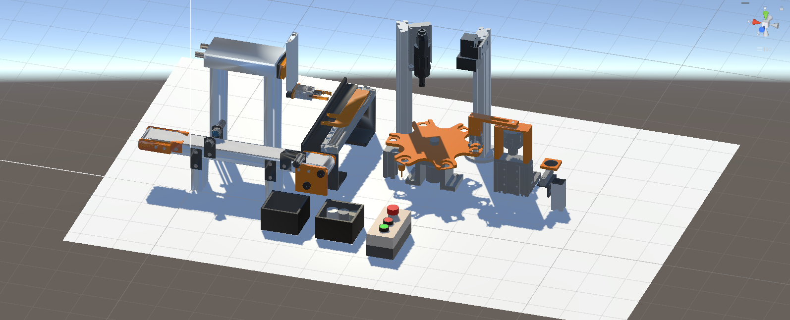
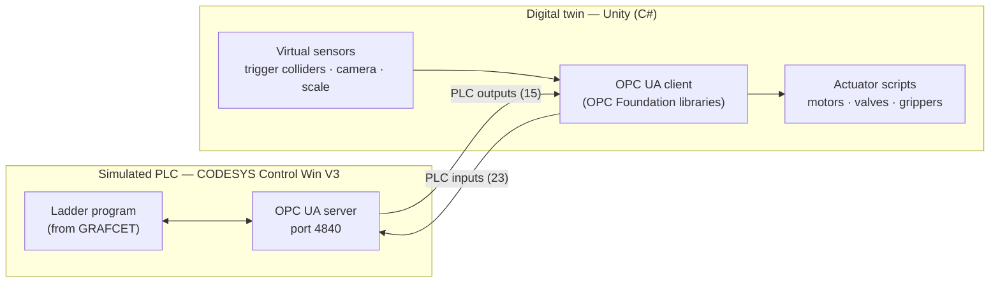
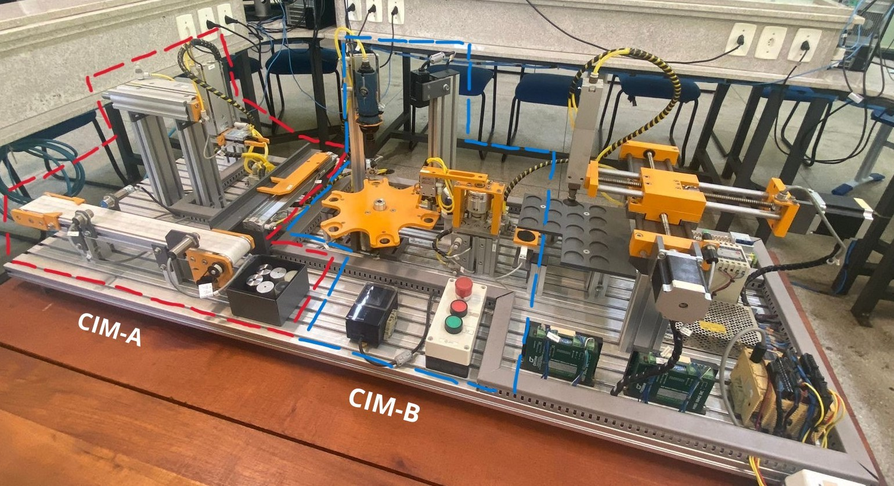

# CIM-C Digital Twin

**3D digital twin of the CIM-C didactic manufacturing plant, controlled by a PLC through OPC UA for Software-in-the-Loop validation of control logic.**

**Authors:** Iago Rangel Gomes · Lucas Faria Schuenck de Souza  
**Advisor:** Prof. Rodolfo Lacerda Valle — CEFET-MG, Leopoldina campus, Brazil




## About the project

The **CIM-C** is a didactic manufacturing plant by De Lorenzo, installed at the Laboratory of Flexible Manufacturing Cells and Robotics of **CEFET-MG, Leopoldina campus (Brazil)** and used in the Integrated Manufacturing Systems course of the Control and Automation Engineering program.

This repository documents its **3D digital twin**: a virtual replica of the plant, built in **Unity**, that reproduces the movements of its actuators and the behavior of its sensors. Like the physical plant, the twin is controlled by a **programmable logic controller (PLC)** — here, a PLC simulated in **CODESYS** — and both exchange sensor and actuator signals in real time through the **OPC UA** protocol. This **Software-in-the-Loop (SiL)** setup allows control logic to be implemented and validated in a simulated environment, without depending on the physical plant.

The project was developed in two B.Sc. theses at CEFET-MG:

| Phase | Year | Author | Scope |
|---|---|---|---|
| 1 | 2023 | Lucas Faria Schuenck de Souza | Digital twin of the first stage (**CIM-A**), OPC UA client in Unity, PLC in Siemens TIA Portal / PLCSIM Advanced |
| 2 | 2025 | **Iago Rangel Gomes** | Digital twin of the second stage (**CIM-B**), integration with CIM-A, migration of the PLC to CODESYS, Ladder control logic for both stages |

## Demo

| Video | Content |
|---|---|
| [youtu.be/hlPfECJXHF8](https://www.youtube.com/watch?v=hlPfECJXHF8) | Phase 2 — complete process of the integrated twin (CIM-A + CIM-B) |
| [youtu.be/78XFZRFa8hI](https://youtu.be/78XFZRFa8hI) | Phase 1 — configuration and operation of the CIM-A twin |

## Highlights

- **Two plant stages, eight modules** — conveyor, linear transfer unit and Cartesian manipulator (CIM-A); six-position rotary table, drilling module, vision system, horizontal handling unit and weighing module (CIM-B) — modeled from measurements of the real plant.
- **38 PLC signals over OPC UA** — 23 inputs (buttons, sensors, weight) and 15 outputs (motors, valves, camera), read and written by a C# OPC UA client inside Unity.
- **Virtual sensors** — limit switches and proximity sensors are emulated with Unity trigger colliders; the vision system checks the hole of metallic workpieces and the scale reads their mass with a ±2 g random deviation.
- **Industrial control logic** — sequence modeled in GRAFCET (steps M0–M50) and implemented in Ladder (IEC 61131-3) in CODESYS.
- **Controller independence** — because communication relies only on OPC UA, the PLC can be replaced by other controllers that support the protocol: the twin was controlled from TIA Portal / PLCSIM Advanced in phase 1 and from CODESYS in phase 2, with the same client scripts.
- **Three workpiece types** — polymer, aluminum and steel, with different routes, hole inspection and weight acceptance criteria.

## How it works



The OPC UA client in Unity **reads the PLC outputs** (motors, valves, camera trigger) and moves the corresponding 3D parts, and **writes the PLC inputs** produced by the virtual sensors (limit switches, proximity sensors, camera result, weight). The sensors of the twin therefore act as PLC inputs, processed by the control program, and its actuators are driven by the PLC outputs, reproducing the behavior of the real plant and closing the Software-in-the-Loop cycle. → [System architecture](docs/03-system-architecture.md)

## The plant



| Stage | Module | Function |
|---|---|---|
| CIM-A | Conveyor unit | Carries the workpiece past inductive, capacitive and optical sensors, which detect it and classify it as metallic or non-metallic |
| CIM-A | Linear transfer unit | Moves the workpiece from the conveyor to the manipulator |
| CIM-A | Cartesian manipulator | Picks the workpiece (vertical and horizontal actuators + gripper) and places it on the rotary table |
| CIM-B | Six-position rotary table | Indexes the workpiece in 60° steps through the CIM-B stations |
| CIM-B | Drilling module | Drills the workpiece |
| CIM-B | Vision system | Inspects the hole of metallic workpieces (3 mm for aluminum, 6 mm for steel) |
| CIM-B | Horizontal handling unit | Transfers the workpiece between the rotary table and the scale |
| CIM-B | Weighing module | Checks the weight (95–105 g aluminum, 115–125 g steel) |

→ [The CIM-C plant in detail](docs/02-the-cim-c-plant.md)

## Tech stack

| Purpose | Tool |
|---|---|
| 3D modeling (CAD) | Autodesk Inventor |
| Materials, hierarchy and pivots | Blender |
| Digital twin, animation and OPC UA client (C#) | Unity 2021.3.16f1 + OPC Foundation .NET libraries |
| Simulated PLC, Ladder program and OPC UA server (phase 2) | CODESYS V3.5 SP20 Patch 5 + CODESYS Control Win V3 |
| Simulated PLC and OPC UA server (phase 1) | Siemens TIA Portal V17 + PLCSIM Advanced V4 |
| OPC UA server inspection | UaExpert 1.7.2 |
| GRAFCET diagrams | diagrams.net |

The phase 2 toolchain is free for academic use (Autodesk Inventor was used with an educational license). In phase 1, TIA Portal and PLCSIM Advanced were used with a 21-day trial license.

## Documentation

| # | Document | Contents |
|---|---|---|
| 1 | [Theoretical background](docs/01-background.md) | Digital twins, Software-in-the-Loop, OPC UA, IEC 61131-3 / Ladder and GRAFCET |
| 2 | [The CIM-C plant](docs/02-the-cim-c-plant.md) | Motivation, stages and modules, workpieces, process flow and signal conventions |
| 3 | [System architecture](docs/03-system-architecture.md) | Components, data flow and controller independence |
| 4 | [OPC UA communication](docs/04-opc-ua-communication.md) | Unity client, CODESYS server (and TIA Portal server of phase 1), NodeIds and configuration screen |
| 5 | [3D modeling and behavior](docs/05-3d-modeling-and-behavior.md) | Inventor → Blender → Unity pipeline and how each module is emulated |
| 6 | [Control logic](docs/06-control-logic.md) | I/O list, GRAFCET sequence (M0–M50) and Ladder implementation |
| 7 | [Operation and results](docs/07-operation-and-results.md) | How the twin is operated, workpiece routes, results and limitations |
| 8 | [Project history and future work](docs/08-history-and-future-work.md) | Phases, contributions, challenges and next steps |
| — | [References](docs/references.md) | Bibliography |

## Repository structure

```
cimc-digital-twin/
├── README.md
├── CITATION.cff     # how to cite this work
├── docs/            # project documentation
│   └── images/
└── ...              # source code (Unity and CODESYS projects) — coming soon
```

## Publications

- I. R. Gomes, *Modelagem e Desenvolvimento de um Gêmeo Digital 3D Aplicado à Planta Didática CIM-C*, B.Sc. thesis (Control and Automation Engineering), CEFET-MG, Leopoldina, Brazil, 2025 (in Portuguese).
- L. F. S. de Souza, *Projeto e Desenvolvimento de um Gêmeo Virtual 3D Aplicado à Automação*, B.Sc. thesis (Control and Automation Engineering), CEFET-MG, Leopoldina, Brazil, 2023 (in Portuguese).
- I. R. Gomes, R. L. Valle, M. F. dos Santos, M. Morais, J. Mendes, and P. Mercorelli, *Software-in-the-Loop Validation of PLC Logic with a 3D Digital Twin of a Didactic Computer-Integrated Manufacturing Plant* (to appear).

## Authors

| Author | Contribution |
|---|---|
| **Iago Rangel Gomes** — iagorg2000@gmail.com | Phase 2: digital twin of CIM-B, integration with CIM-A, migration to CODESYS and Ladder control logic for both stages |
| **Lucas Faria Schuenck de Souza** | Phase 1: digital twin of CIM-A, OPC UA client in Unity, user interface and the first PLC program (TIA Portal) |

**Advisors:** Prof. Rodolfo Lacerda Valle (phases 1 and 2) — rodolfolacerda@cefetmg.br · Prof. Thiago Campos Acácio Paschoalin (co-advisor, phase 1)

Department of Electroelectronics, Federal Center of Technological Education of Minas Gerais (CEFET-MG), Leopoldina, Brazil.

If you use this work, please cite it — see [CITATION.cff](CITATION.cff) or the [publications](#publications) above.
