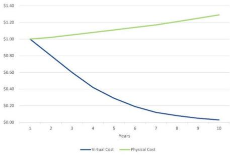
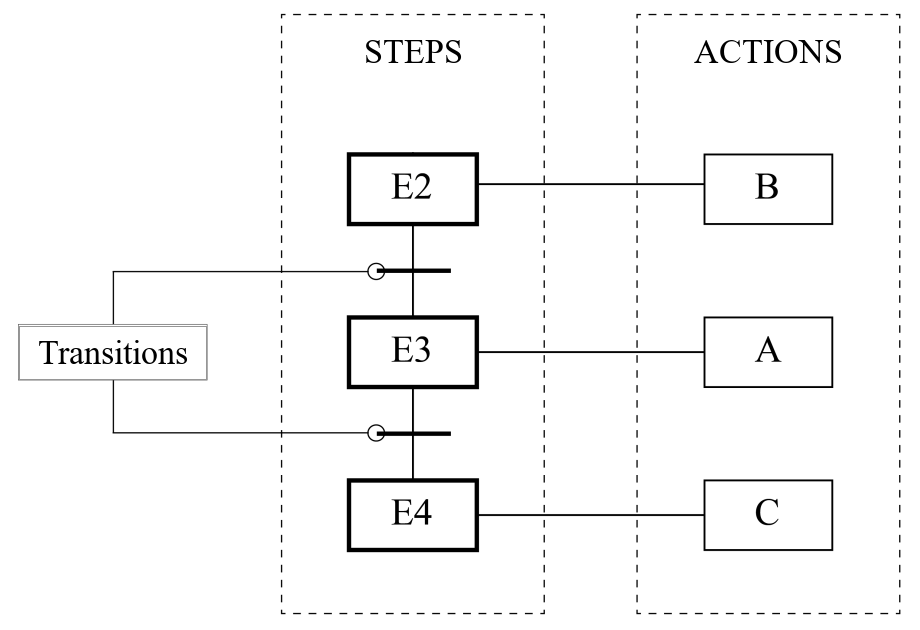

# 1. Theoretical background

This document summarizes the concepts behind the project, based on the theoretical chapters of the two theses that originated it ([Souza, 2023](references.md); [Gomes, 2025](references.md)). All references are listed in [references.md](references.md).

**Contents:** [Industry 4.0](#11-industry-40) · [Digital twins](#12-digital-twins) · [Software-in-the-Loop](#13-software-in-the-loop) · [OPC UA](#14-opc-ua) · [IEC 61131-3 and Ladder](#15-iec-61131-3-and-ladder) · [GRAFCET](#16-grafcet)

---

## 1.1 Industry 4.0

The development of information technologies within industrial processes has benefited production as a whole, reducing costs and providing effective solutions (Cheng et al., 2015, *apud* Santos et al., 2018). In this context, the term **Industry 4.0** refers to the fourth industrial revolution and describes strategies that involve a set of cutting-edge, internet-connected technologies aimed at making production systems more flexible and collaborative (Santos et al., 2018).

With the advent of Industry 4.0, companies have adopted digital and technological transformation to improve their production, reduce costs and remain competitive (Singh et al., 2021). One of these technologies is the **digital twin**, considered a pivot for obtaining competitive and economic advantages (Singh et al., 2021), which has driven the integration of the physical and digital worlds (Tao et al., 2022).

## 1.2 Digital twins

### Definition

A **digital twin (DT)**, also called a virtual twin, is a virtual representation of the real world, ranging from small pieces of equipment to entire industrial plants. It makes it possible to identify future problems and plan strategies to avoid them, which translates into savings for companies (Ochôa, 2021).

DTs integrate the physical and digital worlds through dynamic virtual models connected in real time. Unlike conventional static models or traditional simulations, they are continuously fed with data from IoT systems, sensors and automation platforms, so that the performance, behavior and interactions of physical processes, both large and small, can be replicated and analyzed virtually with precision and detail ([Gomes, 2025](references.md)).

### Origin and evolution

- **2003 — Grieves:** the concept first appeared in a presentation by Michael Grieves at the University of Michigan on Product Lifecycle Management (PLM). His *Conceptual Ideal for PLM* already contained the elements of today's digital twin: a real space, a virtual space, data connections between them, information processes and virtual sub-spaces (Grieves and Vickers, 2017). For Grieves, a DT is a set of virtual information that fully describes a real or potential physical product, from the micro atomic level to the macro geometric level.
- **2003–2011:** the rapid advance of the Internet of Things (IoT), sensors, big-data analytics and simulation drove the emergence of DTs. In 2011, the first article demonstrating the use of a DT to predict the structural life of aircraft was published (Tao et al., 2019).
- **2012 — NASA:** NASA revisited the concept, defining DTs as high-fidelity simulations that reflect the state of the corresponding object in real time, using historical data, real-time sensor data and physical models (Tao et al., 2019).
- **Other definitions:** for Gabor et al. (2016), a DT is a special simulation that combines expert knowledge with real data collected from the existing system, allowing accurate representation at different time and space scales (*apud* Tao et al., 2019). For Hicks (2019), it is the synchronization of useful information about a physical entity in the virtual space, allowing the physical and virtual states to converge through information flows (*apud* Rasheed et al., 2020).

Since then, the concept has evolved significantly, driven by digital technologies, and has been implemented in several areas of industry (Tao et al., 2019). With new communication, sensing and data-analysis technologies, DTs have also incorporated machine learning and artificial intelligence (Katsoulakis et al., 2024).

### Building blocks

A digital twin is built on three main pillars (Singh et al., 2021):

| Pillar | Description |
|---|---|
| Physical element | The real system itself |
| Virtual element | The detailed and accurate digital model of the real system |
| Connection | A bidirectional, real-time flow between the physical and the virtual elements, allowing them to be updated and synchronized |

### Types and maturity

According to their **scope**, digital twins can be classified as (AWS, 2022, *apud* [Souza, 2023](references.md)):

| Type | Scope |
|---|---|
| Component twin | A single part that belongs to a system |
| Asset twin | Two or more components that work together within a broader system |
| System twin | Several assets working together as part of a larger system; can be used to study and improve the efficiency and performance of the system |
| Process twin | The digital environment of an entire object, showing how assets and units work together |

Souza (2023) frames the twin of this project as a **system twin** used in manufacturing, with several assets and units working together as part of a larger system.

According to their **maturity**, DTs can evolve through different stages (Katsoulakis et al., 2024):

| Stage | Description |
|---|---|
| Static twin | A digital replica of the physical system |
| Mirror twin | Reflects the behavior of the physical system in real time, as a synchronized digital copy, without analysis or adaptation capabilities |
| Shadow (self-adaptive) twin | Receives real-time data, processes it and updates the model automatically, identifying patterns and proposing improvements |
| Intelligent twin | Uses artificial intelligence for analysis, prediction and autonomous decision-making, communicating with external systems |

In this project, the twin replicates the behavior of the plant based on the data exchanged with the PLC, without making autonomous decisions.

### Benefits and applications

DTs bring several advantages, including cost-effectiveness, problem prediction and system planning, optimization of solutions, safety regarding the working conditions of some physical sectors, process documentation and accessibility (Singh et al., 2021). Developing solutions and changes on physical plants is slow and expensive because of material and labor costs; a DT requires an initial investment that decreases over time, and the virtual prototype allows several scenarios to be tested without risk to the physical assets, making it possible to predict failures and plan optimized solutions (Grieves and Vickers, 2017, *apud* Singh et al., 2021). DTs also provide **accessibility**, since they allow the physical asset to be simulated remotely (Singh et al., 2021).

  

*Physical versus virtual prototyping costs over time. Source: Singh et al. (2021), as reproduced in [Souza (2023)](references.md), Fig. 1.1.*

Based on an Oracle report, eight benefits of implementing DTs have been identified (Oracle, 2019, *apud* Rasheed et al., 2020):

1. Real-time monitoring and control
2. Greater efficiency and safety
3. Predictive maintenance
4. Scenario and risk assessment
5. Better synergy and collaboration within and between teams
6. More efficient and informed decision-support systems
7. Personalization of products and services
8. Better documentation and communication

These benefits have led to applications in health, meteorology, manufacturing and process technology, education, transport and energy, among others (Rasheed et al., 2020), as well as civil construction and the automotive sector (AWS, 2022).

**In manufacturing**, DTs have gained notoriety in academia and industry, especially in manufacturing and maintenance. They make it possible to test different production scenarios quickly, cost-effectively and before fabrication, improving the process before its implementation in the physical plant and, in some cases, avoiding the interruption of production to test a new scenario or configuration (Errandonea et al., 2020). They allow tests and optimizations to be performed virtually before physical implementation, reducing costs and risks, and enable real-time monitoring and predictive maintenance (Quinalha, 2018). By integrating information from multiple sources into a virtual environment that accurately represents the physical system, they are essential for smart manufacturing (Tao et al., 2019).

**In education**, the growth of DT research requires the training of qualified professionals to implement these systems ([Gomes, 2025](references.md)). DTs of didactic plants allow students to explore the operation of automated systems virtually, without depending on the physical structure — the motivation of this project is described in [The CIM-C plant](02-the-cim-c-plant.md#motivation).

## 1.3 Software-in-the-Loop

**Software-in-the-Loop (SiL)** is the technique used in this project to implement and validate the control logic in a simulated environment ([Gomes, 2025](references.md)). In the context of smart manufacturing and SiL, the DT is mainly used to simulate real production processes, predict failures and increase efficiency and quality (Soori et al., 2023).

In this project, both sides of the loop are virtual: the **plant** is the 3D digital twin built in Unity and the **controller** is a PLC simulated in CODESYS (phase 2) or in Siemens PLCSIM Advanced (phase 1). Because the twin communicates through OPC UA, it can be controlled by either a real or a simulated PLC ([Souza, 2023](references.md)).

## 1.4 OPC UA

**OPC UA** (Open Platform Communications Unified Architecture) is a communication standard used in industrial environments to exchange information between devices, software and control systems. It is the evolution of OPC Classic, created in 1996, whose limitations in security and interoperability motivated the creation of OPC UA in 2006 (Mahnke et al., 2009).

Main characteristics:

- **Open and platform-independent**, designed for secure, scalable and interoperable communication between industrial devices and systems; it standardizes the data exchange between controllers, sensors, actuators and supervisory systems, which makes it one of the main enablers of Industry 4.0 (TeepTrak, 2025).
- **Client/server architecture:** clients request data and services from servers; the server exposes data and services that are accessed by clients through sessions (Mahnke et al., 2009; [Gomes, 2025](references.md)).
- **Information model:** defines how data are organized and structured, allowing interoperability between different systems (Mahnke et al., 2009).
- **Security:** OPC UA supports end-to-end encryption to protect the transmitted information (Mahnke et al., 2009).

Each variable exposed by a server is a **node**, identified by a **NodeId**. For example, the string `ns=2;s=Tag10` represents a node of a test server used in phase 1 ([Souza, 2023](references.md)). The NodeIds are what the client references to read and write each variable — see [OPC UA communication](04-opc-ua-communication.md).

In this project, the Unity twin is the **OPC UA client**, and the simulated PLC hosts the **OPC UA server**: the client reads the PLC outputs (such as actuators and valves) and writes the PLC inputs (such as sensor and button states), so the 3D model reflects the behavior of the plant and the virtual sensors send feedback to the controller in real time, creating a complete SiL cycle ([Gomes, 2025](references.md)).

## 1.5 IEC 61131-3 and Ladder

**IEC 61131-3** is the standard that defines programming languages for PLCs. CODESYS, the development environment used in phase 2, follows this standard and supports languages such as **Ladder**, **Structured Text** and **Function Block Diagram** (CODESYS GmbH, 2025).

**Ladder** is a graphical language standardized by IEC 61131-3 and widely adopted in industrial automation (Lee and Hsu, 2004). Its structure is based on **contacts** and **coils** that simulate electromechanical relays, which makes programming intuitive for professionals coming from electrical command design (DeGuglielmo et al., 2020):

- vertical lines and horizontal rungs represent logical electrical circuits;
- **contacts** represent conditions that can be open or closed, such as sensors or buttons;
- **coils** represent the actions to be executed, such as turning on motors or valves;
- **auxiliary memories** are not directly linked to inputs or outputs but store information used by the logic;
- the program is executed from **left to right and from top to bottom**, evaluating the conditions and driving the corresponding outputs (DeGuglielmo et al., 2020).

## 1.6 GRAFCET

**GRAFCET** (*GRAphe Fonctionnel de Commande Étape Transition*) is a graphical representation standardized by **IEC 60848** that describes the sequential behavior of automated systems through **steps** (states) and **transitions** (conditions for moving between states), facilitating the understanding of the process logic (Mendes, 2022):

- a GRAFCET is a succession of steps; the **actions** associated with a step — driving outputs, timers, counters or memories — are active only while the step is active;
- between two steps there is a **transition**, associated with a condition (**receptivity**), usually related to inputs such as sensors, timer outputs or counters;
- a transition is **enabled** when the step before it is active; when the step is active and the receptivity is satisfied, the following step becomes active and the previous one is deactivated (Mendes, 2022).

  

*Example of part of a GRAFCET: steps E2–E4, the transitions between them and the actions A, B and C associated with each step ([Souza, 2023](references.md), Fig. 3.33).*

The conversion of a GRAFCET into Ladder follows an established methodology in the literature (Moraes and Castrucci, 2007; Mendes, 2022), which was adopted in phase 2 of this project. How GRAFCET and Ladder were used in each phase is described in [Control logic](06-control-logic.md).
