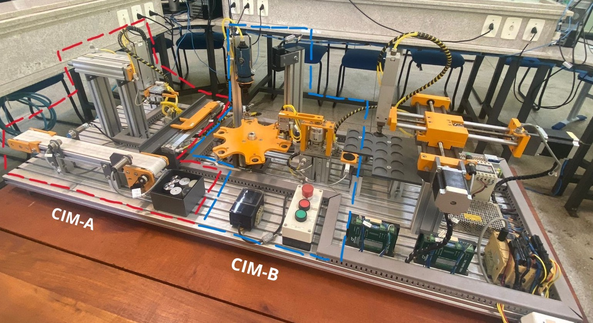
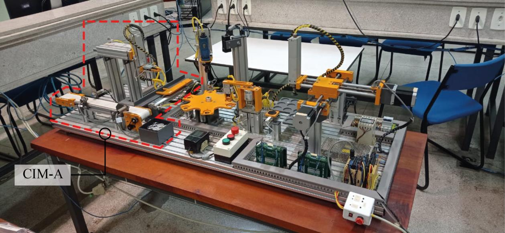
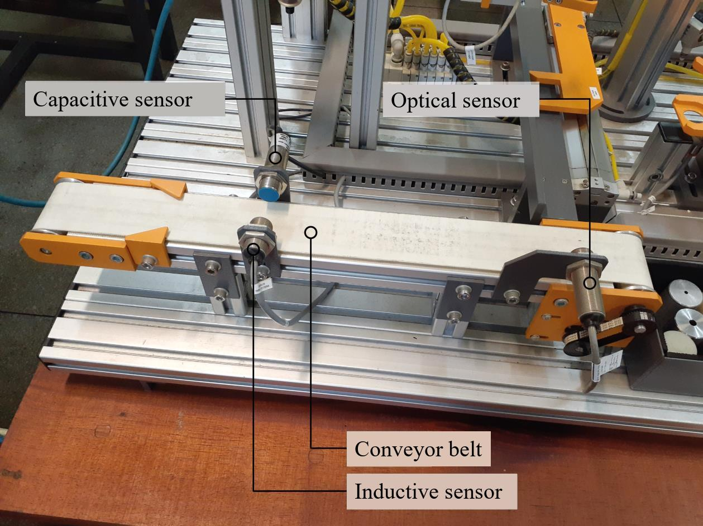
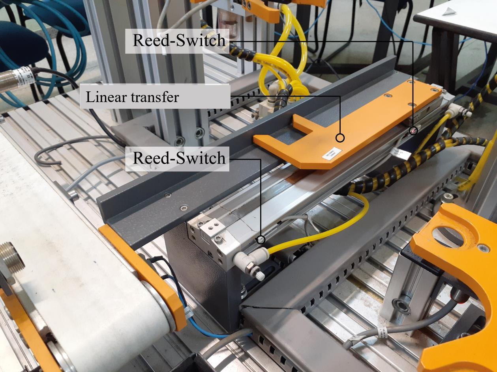
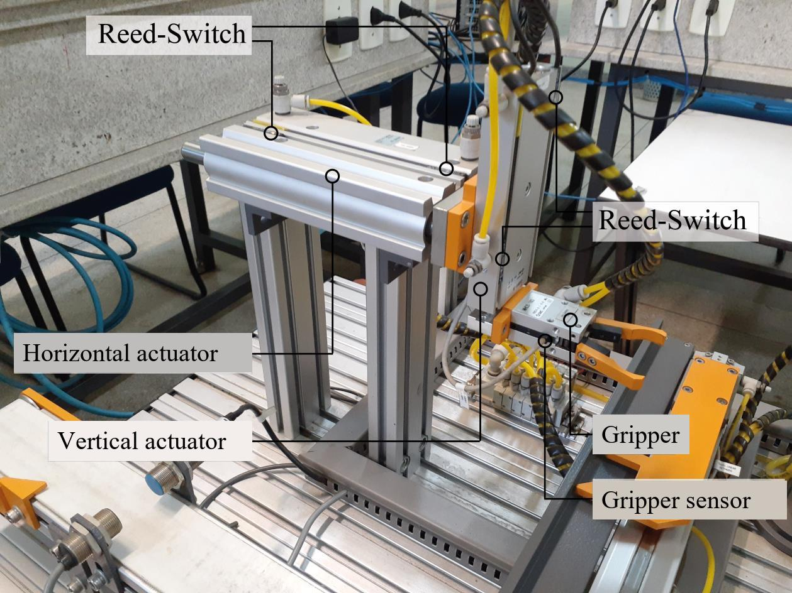
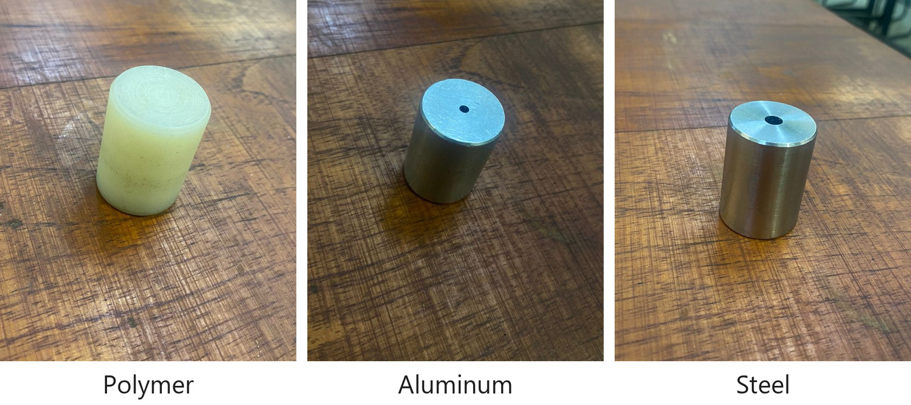
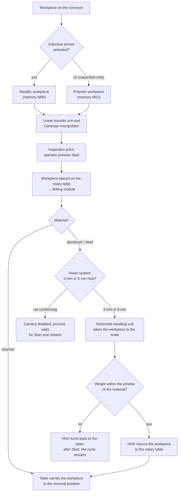

# 2. The CIM-C didactic plant

**Contents:** [Overview](#overview) · [Motivation](#motivation) · [Stages and modules](#stages-and-modules) · [Workpieces](#workpieces) · [Process flow](#process-flow) · [Signal conventions](#signal-conventions)

---

## Overview

The **DL CIM-C** is a didactic manufacturing plant made by **De Lorenzo**, installed at the Laboratory of Flexible Manufacturing Cells and Robotics (room 6-309B) of CEFET-MG, Leopoldina campus, Brazil. It is used in the **Integrated Manufacturing Systems** course of the Control and Automation Engineering program.

The manufacturer also offers simpler models of the same family; the **DL CIM-A** corresponds to the first block of the CIM-C ([Souza, 2023](references.md)). The digital twin covers the first two stages of the plant:

- **CIM-A** — twinned in phase 1 ([Souza, 2023](references.md));
- **CIM-B** — twinned in phase 2 and integrated with CIM-A ([Gomes, 2025](references.md)).

The CIM-C plant contains further modules that are not yet part of the twin (see [future work](08-history-and-future-work.md#future-work)).

*The CIM-C didactic plant, with the twinned stages highlighted: CIM-A (red) and CIM-B (blue).*

## Motivation

In 2020 and 2021, during the COVID-19 pandemic, the Integrated Manufacturing Systems course was taught remotely and students could not have physical contact with the plant. Students developed the PLC user program based on the project requirements presented by the professor; the professor then transferred the program to the CIM-C plant, and a camera streamed its operation during class so that students could detect problems and propose corrections. A single plant was shared by several teams, which became a **bottleneck** for checking failures in the students' programs ([Souza, 2023](references.md)).

A digital twin of the plant, controlled by a PLC, allows students to implement and test the logic developed in class in a realistic virtual environment. Beyond teaching, digital twins of industrial plants can also be used to develop and validate new solutions, to perform operational tests and to train maintenance teams ([Gomes, 2025](references.md)).

## Stages and modules

### CIM-A — first stage

| Module | Devices | PLC outputs | PLC inputs |
|---|---|---|---|
| Conveyor unit | Conveyor belt; **inductive** sensor (identifies metallic workpieces); **capacitive** sensor (detects any workpiece passing at its position); **optical** sensor (detects the workpiece at its position) | 1 (conveyor motor) | 3 |
| Linear transfer unit | Linear transfer actuator and two **reed switches** (electromagnetic limit switches) that detect its extended and retracted positions | 1 | 2 |
| Cartesian handling unit | Vertical actuator with two reed switches; horizontal actuator with two reed switches; gripper with a sensor that indicates whether it is closed | 3 | 5 |
| Push-button station | Start, Stop and Emergency buttons | — | 3 |

The conveyor unit carries the workpiece to the next unit; the linear transfer unit removes it from the conveyor and takes it to the next unit; and the Cartesian handling unit picks it up and delivers it ([Souza, 2023](references.md)) — in the integrated twin, to the rotary table of CIM-B ([Gomes, 2025](references.md)).

  

*The CIM-A stage, highlighted in the CIM-C plant ([Souza, 2023](references.md), Fig. 1.2).*

<table>
  <tr>
    <td width="33%"></td>
    <td width="33%"></td>
    <td width="33%"></td>
  </tr>
  <tr>
    <td align="center"><em>Conveyor unit</em></td>
    <td align="center"><em>Linear transfer unit</em></td>
    <td align="center"><em>Cartesian handling unit</em></td>
  </tr>
</table>

*Modules of the physical CIM-A stage ([Souza, 2023](references.md), Figs. 3.11, 3.17 and 3.23).*

### CIM-B — second stage

| Module | Function | PLC outputs | PLC inputs |
|---|---|---|---|
| Six-position rotary table | Receives the workpiece from the Cartesian manipulator and carries it sequentially through the drilling module, the vision system and the horizontal handling unit; after weighing, the workpiece returns to the table and is taken to the removal position. The table rotates in **60° increments**, completing a turn every six cycles; each 60° step is confirmed by an **inductive sensor** under the table, activated by metal pins fixed equidistantly on its lower face | 1 (motor) | 1 (inductive sensor) |
| Drilling module | Drills the workpiece once it is correctly positioned | 2 (drill motor, vertical feed) | 2 (advanced and retracted limit switches) |
| Vision system | Identifies and classifies the workpieces, checking that the holes are correct so that only conforming workpieces advance. The camera compares the captured image with references stored in a data bank; three Boolean signals (Bank1–Bank3) select the reference | 4 (trigger, Bank1–Bank3) | 1 (camera result) |
| Horizontal handling unit (HHU) | Transfers the workpiece from the rotary table to the weighing module and back, so that only approved workpieces reach the weighing stage. A vertical actuator raises and lowers the gripper, and a horizontal actuator moves it like an articulated arm, with one end facing the table and the other facing the scale | 3 (vertical, horizontal, gripper) | 5 (vertical up/down, horizontal table/scale sides, gripper closed) |
| Weighing module | Last stage of the process: measures the weight of the workpiece and sends it to the PLC, which checks whether it is within the expected range for steel or aluminum | — | 1 (weight value) |

Source: [Gomes (2025)](references.md).

In total, the twinned stages exchange **38 signals** with the PLC: **23 inputs** (13 in CIM-A, 10 in CIM-B) and **15 outputs** (5 in CIM-A, 10 in CIM-B). The complete list is in [Control logic](06-control-logic.md#inputs-and-outputs).

## Workpieces

The plant processes three types of workpieces, each with its own route and processing method ([Gomes, 2025](references.md)):

| Workpiece | Detection on the conveyor | Hole | Vision inspection | Weight acceptance window |
|---|---|---|---|---|
| Polymer | Capacitive sensor only → non-metallic | — | Not inspected | Not weighed |
| Aluminum | Capacitive + inductive → metallic | 3 mm | Bank code 100 | 95–105 g |
| Steel | Capacitive + inductive → metallic | 6 mm | Bank code 010 | 115–125 g |

## Process flow

The flow below summarizes the process implemented in phase 2 for the integrated plant ([Gomes, 2025](references.md)). The detailed step-by-step sequence (GRAFCET steps M0–M50) is described in [Control logic](06-control-logic.md#control-sequence).

- **Polymer:** after being detected only by the capacitive sensor, the workpiece is classified as non-metallic, taken by the linear transfer unit and picked by the Cartesian manipulator, which positions it at the inspection point; after the operator presses Start, it is placed on the rotary table, carried to the drilling station, where it is drilled; the table then performs four more rotations, placing it at the removal station without going through the vision inspection.
- **Aluminum and steel:** after being classified as metallic, the workpiece follows the same path to the rotary table and is drilled (3 mm hole for aluminum, 6 mm for steel). The vision system then checks whether the hole matches the material; if it does not, the system signals an error and waits for the operator to restart the process. Approved workpieces are taken to the weighing module, where the hole identified by the vision system (memories `M02`/`M03`) selects the acceptance window: aluminum must weigh between 95 and 105 g and steel between 115 and 125 g. If the weight is within the window, the HHU returns the workpiece to the table, which carries it to the removal station.

## Signal conventions

The following conventions were defined for the CIM-A devices in phase 1 ([Souza, 2023](references.md)):

| Device | Convention |
|---|---|
| Emergency button | Normally closed (NC) and latching |
| Stop button | Normally closed (NC) |
| Start button | Normally open (NO) |
| Gripper sensor | High = gripper closed; low = gripper open |
| Gripper valve (`Val_Garra_Vert`) | High = open; low = close — so that, in case of power failure, the gripper does not open and drop the workpiece |
| Other actuators | High = advance; low = retract |
| Conveyor motor | High = on; low = off |
| Other sensors | High when an object is detected; low otherwise |

For the CIM-B devices, the behavior defined in phase 2 is ([Gomes, 2025](references.md)):

| Device | Behavior |
|---|---|
| Rotary table motor (`MMesa`) | The table rotates while the output is true |
| Drill feed (`ValFur`) | True → the drill moves down; false → it retracts |
| HHU vertical actuator (`ValUmhV`) | True → moves up until the top position (`UmhVAva`); false → moves down until the base (`UmhVRec`) |
| HHU horizontal actuator (`ValUmhB`) | Set → turns towards the scale; reset → turns back towards the table |
| HHU gripper (`ValUmhG`) | Set → opens; reset → closes |
