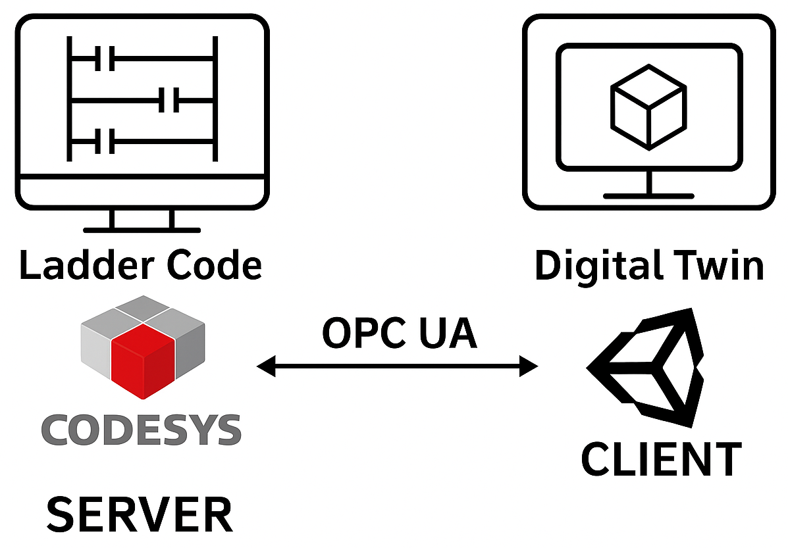
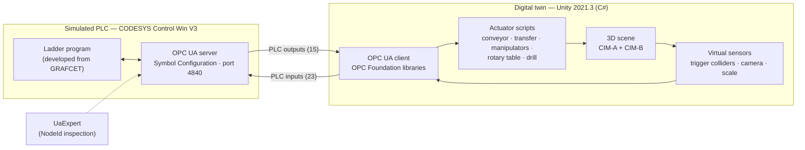
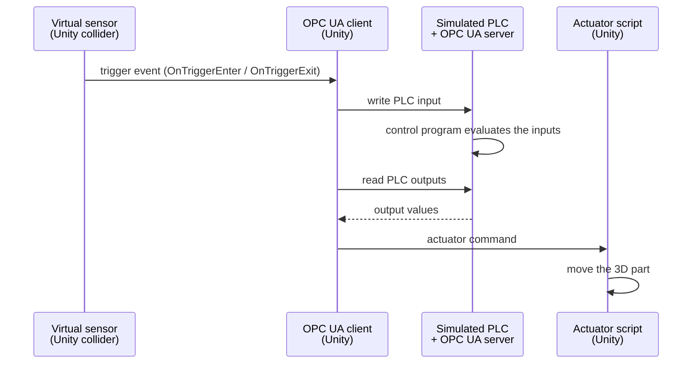
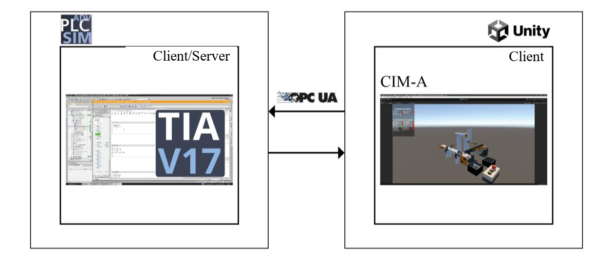

# 3. System architecture

**Contents:** [Overview](#overview) · [Components](#components) · [Data flow](#data-flow-the-software-in-the-loop-cycle) · [Controller independence](#controller-independence) · [Deployment](#deployment)

---

## Overview

The system has two sides connected by OPC UA: a **simulated PLC**, which runs the control program and hosts the OPC UA server, and the **3D digital twin** in Unity, which acts as the OPC UA client ([Gomes, 2025](references.md)).

  

## Components

| Component | Role | Phase 2 (current) | Phase 1 |
|---|---|---|---|
| Simulated PLC | Executes the control program | CODESYS Control Win V3, a soft-PLC that runs locally on Windows | Siemens S7-1500 (CPU 1513-1 PN) simulated in PLCSIM Advanced V4 |
| Control program | Defines the operating sequence of the plant | Ladder, developed in CODESYS V3.5 SP20 Patch 5 from a GRAFCET model | GRAFCET programmed in TIA Portal V17 |
| OPC UA server | Exposes the PLC variables to the twin | CODESYS OPC UA server, configured through a Symbol Configuration object | OPC UA server of the S7-1500, configured in TIA Portal through a data block and a server interface |
| OPC UA client | Reads the PLC outputs and writes the PLC inputs | C# scripts in Unity using the OPC Foundation libraries (DLLs), reused from phase 1 | C# scripts in Unity using the OPC Foundation libraries (`clientOPCUA` class) |
| Digital twin | 3D model of the plant, actuator animation and virtual sensors | CIM-A + CIM-B in Unity 2021.3.16f1 | CIM-A in Unity |
| User interface | Configuration of the OPC UA server address and of the NodeId of each variable | Configuration screen with annotated views of the twin | Main menu, address configuration screen and information panel |
| Support tools | Testing the communication and identifying NodeIds | UaExpert 1.7.2 (Unified Automation), to browse the server address space | Free OPC UA test servers (Integration Objects and Unified Automation), to test the client during development |

Sources: [Souza (2023)](references.md); [Gomes (2025)](references.md). Details of each side are given in [OPC UA communication](04-opc-ua-communication.md) and [3D modeling and behavior](05-3d-modeling-and-behavior.md).

## Data flow: the Software-in-the-Loop cycle

The digital input and output variables of the twin are accessed by the simulated PLC. The **sensors of the twin act as PLC inputs**, which are read and processed by the control program; based on its response, the **actuators of the twin are driven by the PLC outputs**, reproducing the behavior of the real plant ([Gomes, 2025](references.md)).

**Example — one indexing step of the rotary table** ([Gomes, 2025](references.md)):

1. The control program sets the table motor output `MMesa`.
2. The `RotacionarMesa` script reads `MMesa = TRUE` through OPC UA and rotates the table at 25°/s.
3. When one of the six pins under the table enters the collider that represents the inductive sensor, `OnTriggerEnter` fires and the twin writes `SnMesa = TRUE` to the PLC.
4. The transition is satisfied: the program resets `MMesa` and starts the next step (e.g., turning on the drill motor `MFur`).
5. The script reads `MMesa = FALSE` and the table stops, with the workpiece aligned for the next operation.

## Controller independence

Because the twin interacts with the controller only through an OPC UA server, it can be controlled by a **real or a simulated PLC** ([Souza, 2023](references.md)), and by other controllers that also support the protocol. The application is therefore not limited to a specific environment or manufacturer and can be adapted to different industrial platforms ([Gomes, 2025](references.md)).

This was put into practice between the two phases of the project:

| | Phase 1 | Phase 2 |
|---|---|---|
| PLC environment | Siemens TIA Portal V17 + PLCSIM Advanced V4 | CODESYS V3.5 SP20 Patch 5 + Control Win V3 |
| License | 21-day trial | Free for educational purposes |
| OPC UA client in Unity | Developed in phase 1 | Same scripts, kept unchanged |

CODESYS was adopted in phase 2 because it is a free platform, with native OPC UA support and compatibility with several manufacturers ([Gomes, 2025](references.md)).

  

*Phase 1 schematic: the CIM-A twin in Unity (client) exchanges the digital inputs and outputs through OPC UA with the PLC simulated in PLCSIM Advanced, whose user program is developed in TIA Portal V17 ([Souza, 2023](references.md), Fig. 1.3).*

## Deployment

- **Phase 2:** the CODESYS Control Win V3 runtime simulates the PLC locally and runs the OPC UA server on Windows. In the tests, the twin connected to the server through its **local address** (`127.0.0.1:4840`); the server also listens on the computer's **external address**, which could be used to access it from another device on the same local network ([Gomes, 2025](references.md)).
- **Phase 1:** the Unity application was built for **Windows and Linux** ([Souza, 2023](references.md)).
- **Security:** in both phases, security requirements were simplified to limit the scope of the projects — the client accepts untrusted certificates, the server security level was not configured in phase 1, and anonymous connections were enabled in phase 2 ([Souza, 2023](references.md); [Gomes, 2025](references.md)).
