# 4. OPC UA communication

The digital twin (Unity) is the **OPC UA client** and the simulated PLC hosts the **OPC UA server**. This document describes how each side was built and configured. For the concepts, see [Theoretical background — OPC UA](01-background.md#14-opc-ua).

**Contents:** [Client in Unity](#41-opc-ua-client-in-unity) · [Server in CODESYS (phase 2)](#42-opc-ua-server-in-codesys-phase-2) · [Server in TIA Portal (phase 1)](#43-opc-ua-server-in-tia-portal-phase-1) · [Configuration screen](#44-configuration-screen)

---

## 4.1 OPC UA client in Unity

The client was developed in phase 1, in C#, inside the Unity project of the twin ([Souza, 2023](references.md)), and was reused unchanged in phase 2 ([Gomes, 2025](references.md)).

**Libraries.** The client uses the dynamic-link libraries (DLLs) of the **OPC Foundation**, available on the organization's website, inserted into the Unity project so that they can be used by the C# scripts.

**Development.** The code samples provided by the OPC Foundation were studied to understand how the connection and the data exchange are made — among them the *Boiler Client*, a Windows Forms application that connects to and exchanges data with the *Boiler Server*. This study showed that the connection requires the `ApplicationConfiguration` and `Session` classes of the libraries ([Souza, 2023](references.md)).

**Security.** Since the focus of the project was the digital twin, security requirements were simplified to limit its scope: the client accepts untrusted certificates. The code also defines the session timeout, the server address and the required security level ([Souza, 2023](references.md)).

Excerpt of the client configuration and session creation (transcribed from [Gomes, 2025](references.md), Fig. 3.2):

```csharp
ApplicationConfiguration OpcUa_Client_Configuration()
{
    var config = new ApplicationConfiguration()
    {
        ApplicationName = "OPCUA_TCC",

        SecurityConfiguration = new SecurityConfiguration{ ApplicationCertificate =
        new CertificateIdentifier (), AutoAcceptUntrustedCertificates = true,
        AddAppCertToTrustedStore = true},
        TransportQuotas = new TransportQuotas { OperationTimeout = 10000 },
        ClientConfiguration = new ClientConfiguration { DefaultSessionTimeout = 50000 },
    };

    config.Validate(ApplicationType.Client).GetAwaiter().GetResult();

    return config;
}

Session OpcUa_Create_Session(ApplicationConfiguration client_configuration, EndpointDescription client_end_point)
{
    return Session.Create(client_configuration, new ConfiguredEndpoint(null, client_end_point,
    EndpointConfiguration.Create(client_configuration)), false, "", 10000, null, null).GetAwaiter().GetResult();
}

void upcua_ready()
{
    app_configuration = OpcUa_Client_Configuration();
    EndpointDescription end_point = CoreClientUtils.SelectEndpoint(server_address, useSecurity: false);
    m_session = OpcUa_Create_Session(app_configuration, end_point);
}
```

**First tests (phase 1).** The client was first tested against the free OPC UA server of **Integration Objects**, recommended by the OPC Foundation and used only for these initial tests. A Boolean variable of that server, with NodeId `ns=2;s=Tag10`, was used to validate both operations ([Souza, 2023](references.md)):

- **Read:** `ReadValue` reads the node, after `NodeId.Parse` converts the string `"ns=2;s=Tag10"` into a NodeId object;
- **Write:** `WriteValue` writes a Boolean value to the node, called from a button of the Unity interface:

```csharp
public void escreveTAG0(bool i)
{
    variavelNodeId = new NodeId("ns=2;s=Tag10");
    WriteValue writeValue = new WriteValue();
    writeValue.NodeId = variavelNodeId;
    writeValue.AttributeId = Attributes.Value;
    writeValue.Value.Value = i;
    WriteValueCollection valuesToWrite = new WriteValueCollection();
    valuesToWrite.Add(writeValue);
    StatusCodeCollection status = null;
    DiagnosticInfoCollection diagnosticInfos = null;
    SESSION.Write(null, valuesToWrite, out status, out diagnosticInfos);
}
```

*Writing a Boolean variable to the test server, transcribed from [Souza (2023)](references.md), Fig. 3.7.*

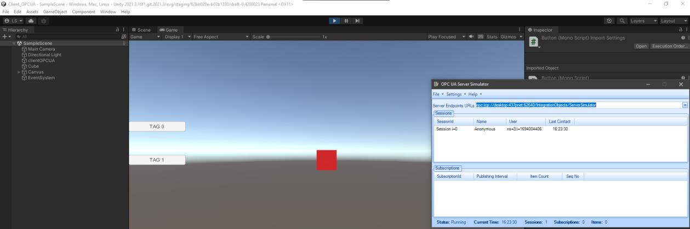

*Unity client connected to the Integration Objects OPC UA test server ([Souza, 2023](references.md), Fig. 3.5).*

**`clientOPCUA` class.** From these tests, the `clientOPCUA` class was developed: it reads all the variables of the plant and writes the data according to the actions of the twin. The address of each variable is entered by the user in the [configuration screen](#44-configuration-screen) ([Souza, 2023](references.md)). The sensor and actuator scripts of each module call methods of this class to exchange their signals with the PLC — see [3D modeling and behavior](05-3d-modeling-and-behavior.md).

## 4.2 OPC UA server in CODESYS (phase 2)

In phase 2, the server was created in **CODESYS**, chosen for its native OPC UA support and for allowing a PLC to be simulated, which significantly simplifies the implementation of the communication between the PLC and the twin. CODESYS is also free for educational purposes ([Gomes, 2025](references.md)).

### Step by step

The procedure below follows [Gomes (2025)](references.md), Section 3.2.

**1. Start the simulated PLC.** Run **CODESYS Control Win V3**, which simulates a PLC locally and runs the OPC UA server on Windows. It is the "core" of the virtual PLC: without it, the server is not accessible.

**2. Check that the server is listening.** In the Windows Command Prompt, run:

```bat
netstat -aon | findstr :4840
```

The command shows whether the default OPC UA port, **4840**, is in use. In the tests, the server was waiting for connections both on the local interface (`127.0.0.1:4840`) and on the computer's external address on the local network.

**3. Allow anonymous connections.** In the device security settings in CODESYS, open the **CmpUserMgr** tab and set **UserMgmtAllowAnonymous** to **YES**. This allows clients such as Unity to connect without a user name and password.

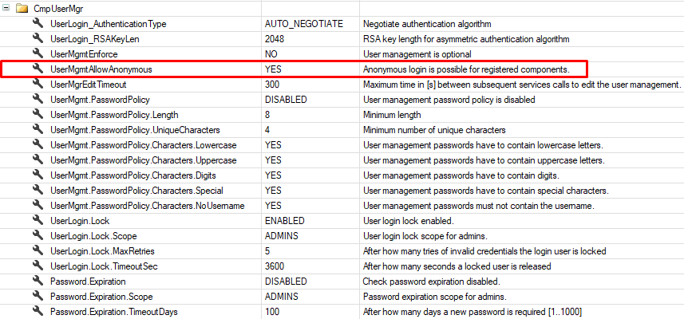

**4. Expose the variables.** Add a **Symbol Configuration** object to the project and select the variables that must be accessible to the client, so that they are exposed in the address space of the server. When creating the object, the option **Support OPC UA features** must be checked.

**5. Build.** Build the Symbol Configuration so that the changes take effect.

**6. Identify the NodeIds.** Use **UaExpert** to browse the node structure of the server and inspect the NodeId and other properties of each variable. These unique identifiers are what the Unity client must reference to read and write each variable.

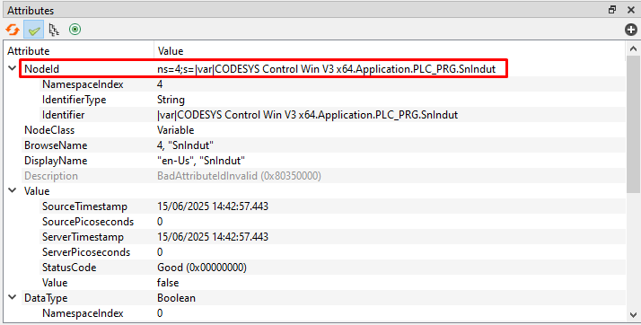

*NodeId of the variable `SnIndut` in UaExpert: `ns=4;s=|var|CODESYS Control Win V3 x64.Application.PLC_PRG.SnIndut` — namespace index 4, string identifier ([Gomes, 2025](references.md), Fig. 3.7).*

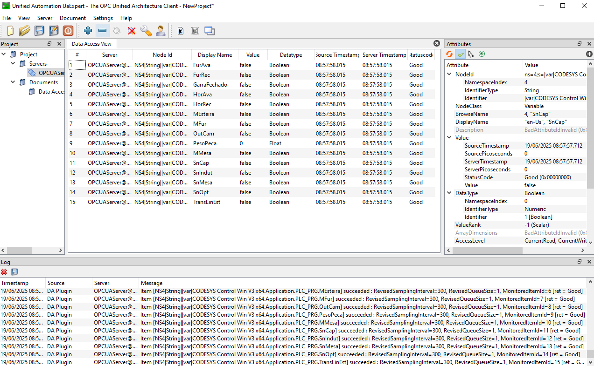

*UaExpert monitoring the plant variables: all are Boolean, except the weight `PesoPeca`, which is a Float ([Gomes, 2025](references.md), Fig. 2.5).*

With the server running and the variables mapped, OPC UA clients can connect to its IP address and port (local or external) to read, write and monitor the variables in real time.

### Communication test

To validate the communication before modeling the plant, a Boolean variable `btnStart` was declared in CODESYS and added to the Symbol Configuration ([Gomes, 2025](references.md)):

1. after building the project, its NodeId was identified in UaExpert;
2. the NodeId and the local address of the server were assigned in a Unity script:

   ```csharp
   public void Start()
   {
       // Servidor
       ServerOPCUA.text = "opc.tcp://127.0.0.1:4840";
       //Botoes
       BtnStart.text = "ns=4;s=|var|CODESYS Control Win V3 x64.Application.PLC_PRG.btnStart";

       // Atribuindo o valor dos NodeIds as variaveis "Servidor" e "btnStart"
       PlayerPrefs.SetString("Servidor", ServerOPCUA.text);
       PlayerPrefs.SetString("btnStart", BtnStart.text);
   }
   ```

3. a reading script retrieved the value of the variable (TRUE or FALSE) in real time;
4. whenever `btnStart` became TRUE, the twin rotated an orange cube by 45°:

   ```csharp
   void Update()
   {
       // Acessa a variavel btnStart (Entrada_Leitura_AUX[0])
       bool currentState = clientObject.GetComponent<clientOPCUA>().Entrada_Leitura_AUX[0] == "True";

       if (currentState && !previousState)
       {
           // Rotaciona o cubo
           RotateCube();
       }
       previousState = currentState;
   }

   void RotateCube()
   {
       transform.Rotate(Vector3.up * rotationAngle); // Rotacao o cubo no eixo Y
   }
   ```

This was the first functional experiment of controlling the twin through commands issued by the PLC via OPC UA. The communication could also use the external IP address of the server (`192.168.X.X`), enabling remote access from another device on the same local network.

*Code excerpts transcribed from [Gomes (2025)](references.md), Figs. 3.9 and 3.12; comments are in Portuguese, as in the original code.*

## 4.3 OPC UA server in TIA Portal (phase 1)

In phase 1, the server was developed in **Siemens TIA Portal V17** together with **PLCSIM Advanced V4**, available for download with a 21-day trial license. Because of the license period, other free servers recommended by the OPC Foundation — from **Integration Objects** and **Unified Automation** — were also used to test the client ([Souza, 2023](references.md)).

The procedure was:

1. **PLC selection:** a CPU of the **S7-1500** series, model **1513-1 PN**, compatible with PLCSIM Advanced and with the option of creating an OPC UA server.
2. **Data block:** a data block (DB) with the names of the variables to be used was added.

   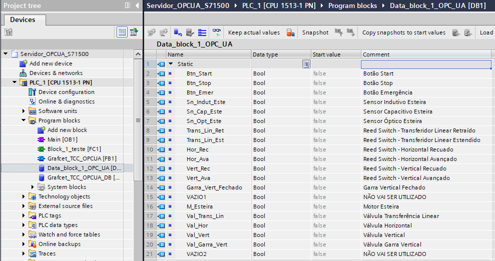

   *Data block with the CIM-A variables in TIA Portal; the comment column is in Portuguese ([Souza, 2023](references.md), Fig. 3.8).*

3. **Server interface:** an OPC UA server interface was created, containing the variables of the DB; it generates the OPC UA address of each variable, and **the order of insertion affects the addressing**.
4. **Device configuration:** in the device configuration, the OPC UA server was activated, its address checked and its response time defined. The security level of the server can also be configured there, but this was not done, since the project had academic purposes.

   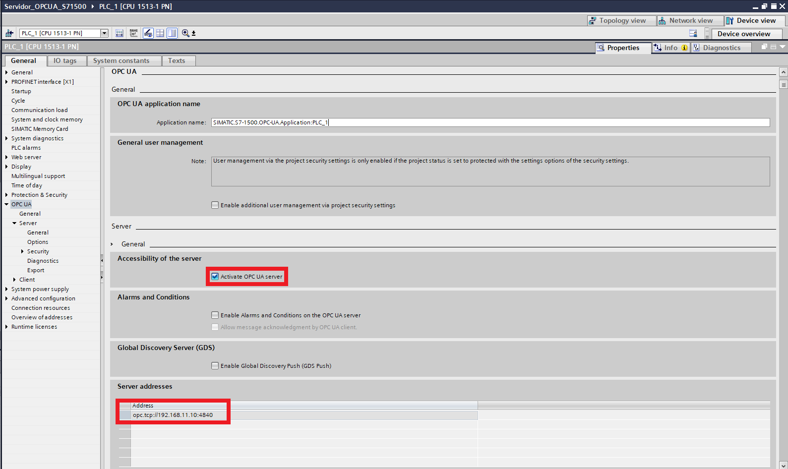

   *Activation of the OPC UA server and server address in the device configuration ([Souza, 2023](references.md), Fig. 3.9).*

5. **Download to PLCSIM:** a virtual PLC was created in PLCSIM with an IP address, subnet mask and name. The IP must be the same configured in TIA Portal, and PLCSIM must run in **PLCSIM Virtual Eth. Adapter** mode to work as an OPC UA server.

   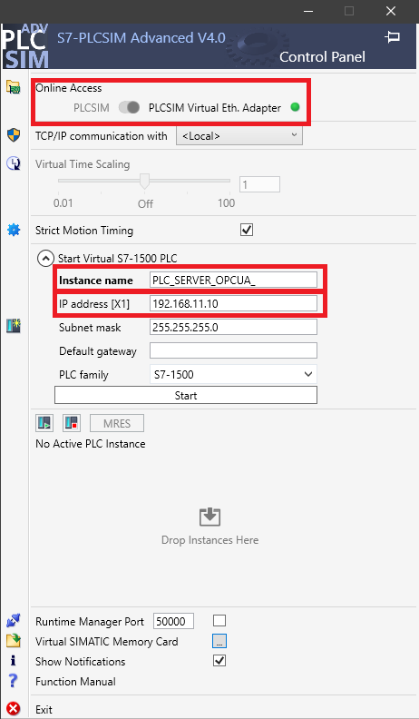

   *PLCSIM Advanced V4 control panel ([Souza, 2023](references.md), Fig. 3.10).*

With this configuration, the variables received numeric NodeIds in namespace 4 (`ns=4;i=2` to `ns=4;i=20`), listed in [Control logic](06-control-logic.md#phase-1-cim-a-in-tia-portal).

## 4.4 Configuration screen

The twin does not have the NodeIds hard-coded: they are entered by the user at run time.

**Phase 1** ([Souza, 2023](references.md)):

- A **main menu** gives access to the twin and to the connection settings.
- In the **settings**, the user enters the address of the OPC UA server and the address of each variable of the twin, using Unity *Input Field* components; each address is stored as a string.
- The menu and the twin are in **separate Unity scenes**: one contains only the start menu and the address configuration, and the other contains the 3D elements of the twin and its interface. The addresses are shared between the scenes with `PlayerPrefs.SetString(key, value)` and `PlayerPrefs.GetString(key)`.
- An image of the twin identifying each variable was added to the configuration menu.
- The scene of the twin has an **information panel** showing the state of the sensors and actuators: green when the signal is true (activated or on) and red when it is false.

<table>
  <tr>
    <td width="40%">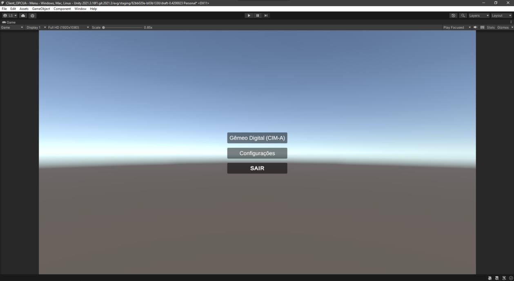</td>
    <td width="60%">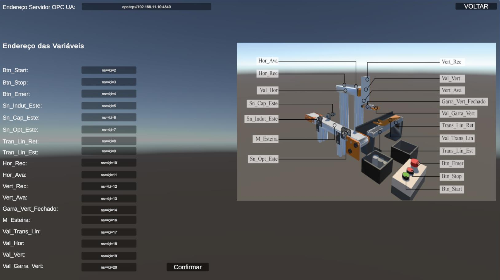</td>
  </tr>
  <tr>
    <td align="center"><em>Main menu: digital twin (CIM-A), configuration and exit</em></td>
    <td align="center"><em>Address configuration with the PLCSIM Advanced addresses</em></td>
  </tr>
</table>

<p align="center">
  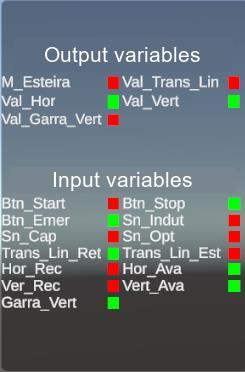
</p>

*Phase 1 interface: main menu, address configuration and information panel ([Souza, 2023](references.md), Figs. 3.28, 4.1 and 3.32). Labels of the configuration screen are in Portuguese ("Endereço Servidor OPC UA" = OPC UA server address; "Endereço das Variáveis" = variable addresses).*

**Phase 2** ([Gomes, 2025](references.md)): before starting the simulation, the user enters, in the configuration screen, the address of the OPC UA server and the NodeIds of the 38 input and output variables of both stages. The screen also shows views of the twin annotated with the variable associated with each device.

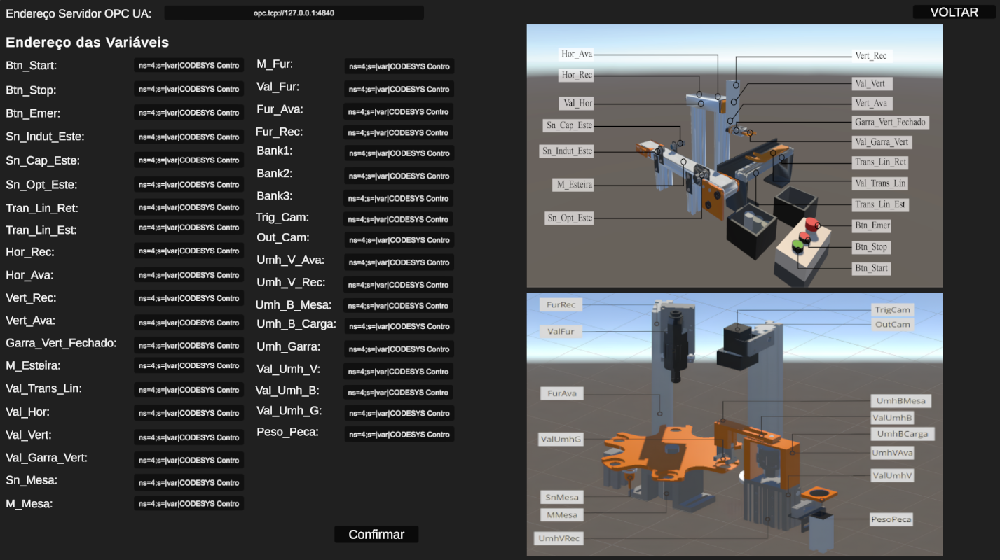

*Configuration screen of the integrated twin (labels in Portuguese: "Endereço Servidor OPC UA" = OPC UA server address; "Endereço das Variáveis" = variable addresses; "Confirmar" = confirm; "Voltar" = back) ([Gomes, 2025](references.md), Fig. 4.4).*

Once the addresses are defined, the system is ready: Unity connects to the PLC, which executes the programmed logic, and the data exchange takes place in real time.
