# 5. 3D modeling and behavior

This document describes how the plant was modeled and how the behavior of each module — actuators and sensors — was reproduced in Unity.

**Contents:** [Modeling pipeline](#51-modeling-pipeline) · [Unity building blocks](#52-unity-building-blocks) · [Workpieces](#53-workpieces) · [CIM-A modules](#54-cim-a-modules-phase-1) · [CIM-B modules](#55-cim-b-modules-phase-2) · [Summary](#56-summary)

---

## 5.1 Modeling pipeline

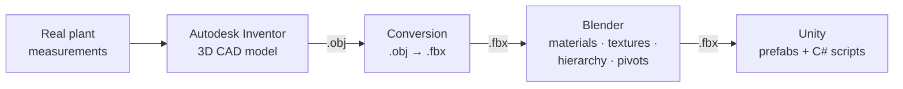

1. **Measurements.** The components were measured on the real plant so that the twin would be faithful to the physical model ([Souza, 2023](references.md)). In phase 2, the CIM-B components were measured with a digital caliper (model MTX-316119), so that the twin reflects the dimensions of the physical elements and integrates correctly with CIM-A ([Gomes, 2025](references.md)).
2. **Autodesk Inventor.** Each module was modeled as a solid 3D model, without physical properties or movements, since the animation is done in Unity. To save time and keep the solution simple, only the **functional modules** (those that move) were modeled; pneumatic hoses, electrical wires and the solenoid were left out. Each unit was modeled separately and later unified in Unity ([Souza, 2023](references.md)).
3. **OBJ → FBX.** The models were exported in OBJ format, which preserves the geometry, and converted to FBX (in phase 1, with Autodesk FBX Converter). OBJ was not used directly in Blender because of problems after the import: incompatibilities in the organization of the model hierarchy (such as the separation into groups) and cuts in the viewport during navigation prevented the refinement of the model ([Souza, 2023](references.md); [Gomes, 2025](references.md)).
4. **Blender.** Materials and textures were applied, the objects were organized in a hierarchy and their pivots (centers of gravity) were defined. The **hierarchy** is the dependency structure between components — it defines, for example, that the movement of a mechanical arm drives the axes or grippers attached to it — so that, when animated, each part respects the mechanical relations of the physical plant ([Souza, 2023](references.md); [Gomes, 2025](references.md)).
5. **Unity.** The models were imported as **prefabs**, which allows the components to be reused, quickly adjusted and animated in a standardized way, and were animated with C# scripts ([Gomes, 2025](references.md)).

<table>
  <tr>
    <td width="44%">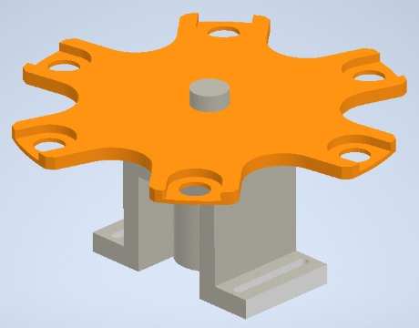</td>
    <td width="56%">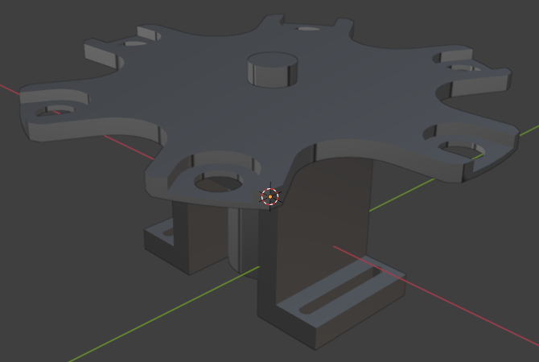</td>
  </tr>
  <tr>
    <td align="center"><em>(a) Autodesk Inventor</em></td>
    <td align="center"><em>(b) Blender</em></td>
  </tr>
  <tr>
    <td colspan="2">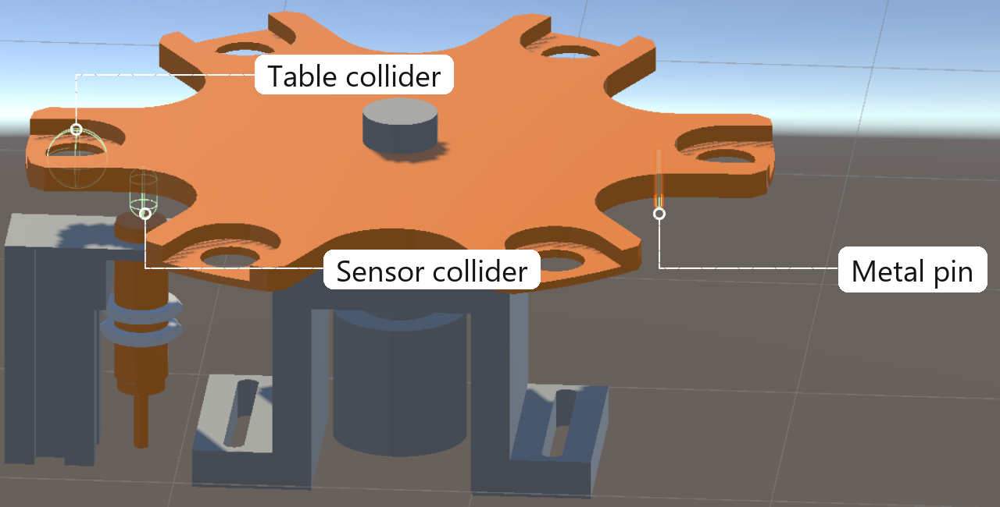</td>
  </tr>
  <tr>
    <td colspan="2" align="center"><em>(c) Unity, with the colliders that hold the workpiece and emulate the inductive sensor</em></td>
  </tr>
</table>

*Modeling pipeline of the six-position rotary table ([Gomes, 2025](references.md)).*

## 5.2 Unity building blocks

The behavior of the twin relies on a few Unity features ([Souza, 2023](references.md); [Gomes, 2025](references.md)):

| Feature | Use in the twin |
|---|---|
| **Collider with `isTrigger` enabled** | Works as a trigger volume: it does not respond physically to contact with another object but fires `OnTriggerEnter()` and `OnTriggerExit()`, detecting objects without affecting their movement or physics. Used to emulate sensors and limit switches and to detect workpieces |
| **Collider with `isTrigger` disabled** | Behaves as a solid physical object, with a real physical response to collisions. Used on the workpieces |
| **Rigidbody** | Adds physics to an object, such as gravity. Used on the workpieces, and to read their mass on the scale |
| **Tags** | Identify the material of each workpiece |
| **`transform`** | Controls the position, rotation and scale of objects; `transform.Translate` and `transform.rotation` move and rotate parts, and `Lerp` interpolates between two points |
| **`transform.parent`** | Makes a workpiece a child of the table or gripper that holds it, so that it moves together with them |
| **`clientOPCUA` class** | Each sensor or actuator script calls methods of this class to write or read its PLC signal — see [OPC UA communication](04-opc-ua-communication.md#41-opc-ua-client-in-unity) |

## 5.3 Workpieces

The three workpiece types — **steel, aluminum and polymer** — were modeled in Autodesk Inventor. Each one has a collider (with `isTrigger` disabled), a Rigidbody and a tag that identifies its material, so that the sensors can tell them apart ([Souza, 2023](references.md)). In phase 2, each workpiece also carries a `Specification` component that stores its characteristics, such as the hole diameter (`spec.furo`) read by the vision system ([Gomes, 2025](references.md)).

To start a cycle, a workpiece is added to the twin by clicking on one of the three pieces located in the box at the end of the conveyor ([Souza, 2023](references.md)).

## 5.4 CIM-A modules (phase 1)

Source: [Souza (2023)](references.md), Section 3.3.

### Conveyor unit

- Modeled in two blocks: the conveyor belt — the only moving object of this unit — and the structure with the sensors.
- Colliders with `isTrigger` enabled were placed on the conveyor and on the sensors.
- When a workpiece reaches the conveyor, it fires the `OnTriggerEnter()` of the conveyor collider and is added to an `ArrayList` called `objetos`; every object in this list moves towards the negative X axis, with its position incremented according to the conveyor speed (method `Movimento` of the `Esteira` class).
- When the workpiece passes by a sensor, the sensor's `OnTriggerEnter()` updates the corresponding variable of the `clientOPCUA` class. Since the tag of each workpiece identifies its material, the capacitive sensor detects both metallic and non-metallic workpieces — its variable becomes TRUE when the object enters the collider and FALSE when it leaves — while the inductive sensor identifies the metallic ones.

<table>
  <tr>
    <td width="50%">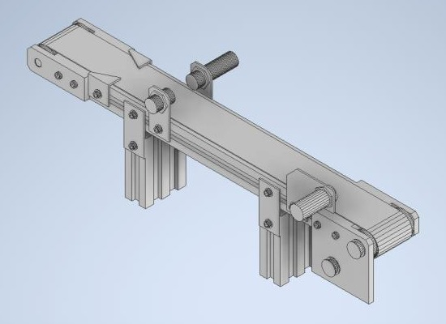</td>
    <td width="50%">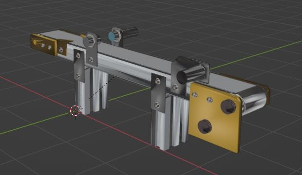</td>
  </tr>
  <tr>
    <td align="center"><em>(a) Autodesk Inventor</em></td>
    <td align="center"><em>(b) Blender</em></td>
  </tr>
  <tr>
    <td colspan="2">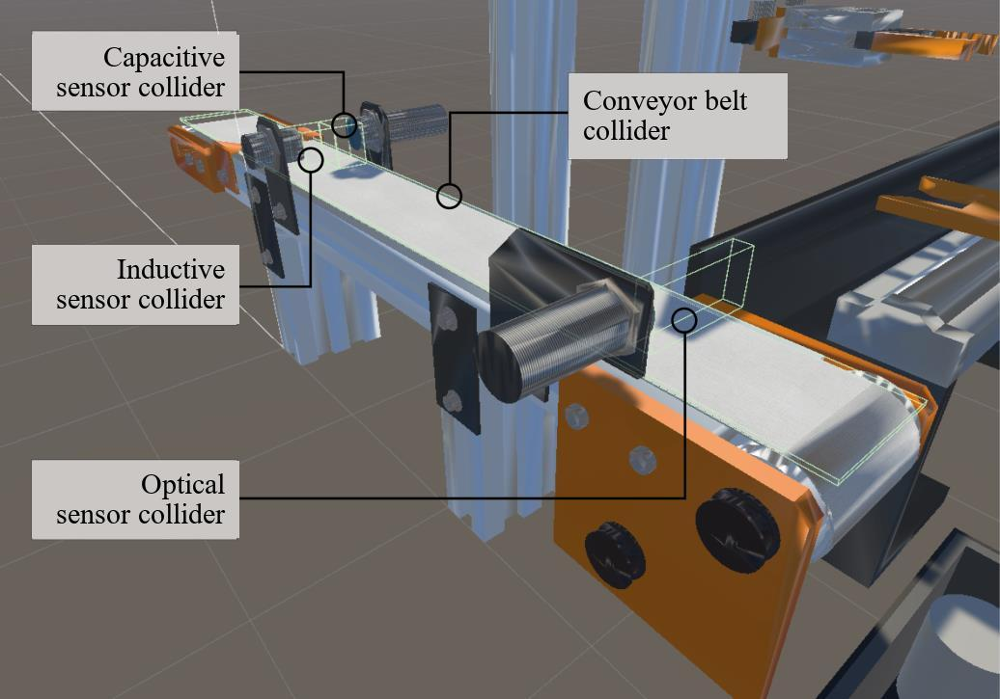</td>
  </tr>
  <tr>
    <td colspan="2" align="center"><em>(c) Unity, with the colliders of the conveyor belt and of the three sensors</em></td>
  </tr>
</table>

*Modeling pipeline of the conveyor unit ([Souza, 2023](references.md), Figs. 3.12–3.14).*

### Linear transfer unit

- The advance and retraction of the linear transfer are implemented with `transform` and `Lerp`, which interpolates the position between two points:

  ```csharp
  public void MovimentaTransferidorAvanca()
  {
      transform.position = Vector3.Lerp(transform.position, ponto02.position, speed * Time.deltaTime);
  }

  public void MovimentaTransferidorRecua()
  {
      transform.position = Vector3.Lerp(transform.position, ponto01.position, speed * Time.deltaTime);
  }
  ```

- Each reed switch is a collider placed on an empty object at each end of the stroke: when the transfer reaches it, `OnTriggerEnter()` is fired, and when it leaves, `OnTriggerExit()`. Each method changes a variable of the `clientOPCUA` class, which sends the signal to the virtual PLC through OPC UA:

  ```csharp
  public void OnTriggerEnter(Collider other)
  {
      if (other.gameObject.tag == "RS_Trans_Lin_Ret")
      {
          clientOPCUA otherClassInstance = GameObject.FindObjectOfType<clientOPCUA>();
          otherClassInstance.Trans_Lin_Ret(true);
      }
      if (other.gameObject.tag == "RS_Trans_Lin_Est")
      {
          clientOPCUA otherClassInstance = GameObject.FindObjectOfType<clientOPCUA>();
          otherClassInstance.Trans_Lin_Est(true);
      }
  }

  public void OnTriggerExit(Collider other)
  {
      if (other.gameObject.tag == "RS_Trans_Lin_Ret")
      {
          clientOPCUA otherClassInstance = GameObject.FindObjectOfType<clientOPCUA>();
          otherClassInstance.Trans_Lin_Ret(false);
      }
      if (other.gameObject.tag == "RS_Trans_Lin_Est")
      {
          clientOPCUA otherClassInstance = GameObject.FindObjectOfType<clientOPCUA>();
          otherClassInstance.Trans_Lin_Est(false);
      }
  }
  ```

  *Code excerpts transcribed from [Souza (2023)](references.md), Figs. 3.20 and 3.22.*

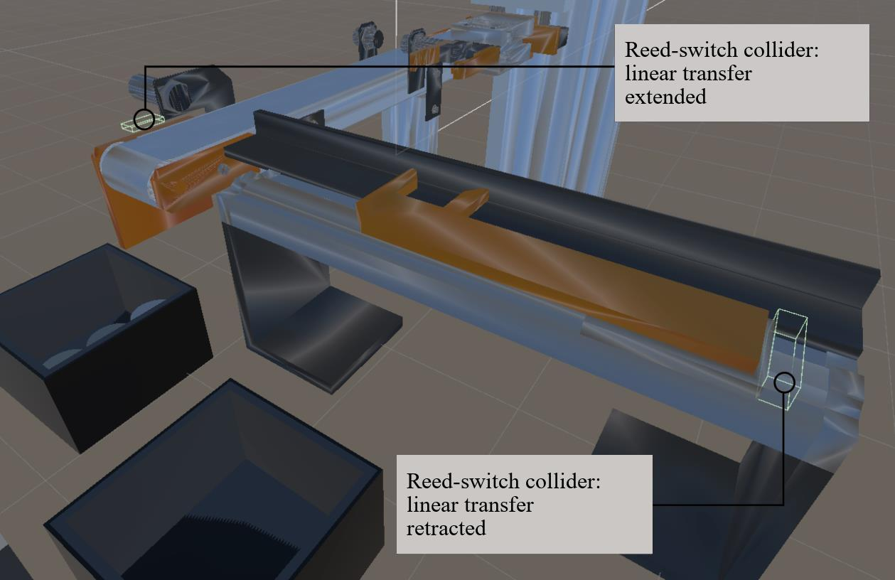

### Cartesian handling unit

- The vertical and horizontal actuators use the same logic and code as the linear transfer, advancing and retracting to the defined points, with reed switches emulated by colliders on empty objects at the ends of each actuator.
- The gripper animation has two parts: the **opening and closing** of the fingers, made with `transform.rotation` and `Lerp`; and **picking the workpiece**, made with `transform.parent`, so that the gripper becomes the parent of the workpiece and carries it to other positions.

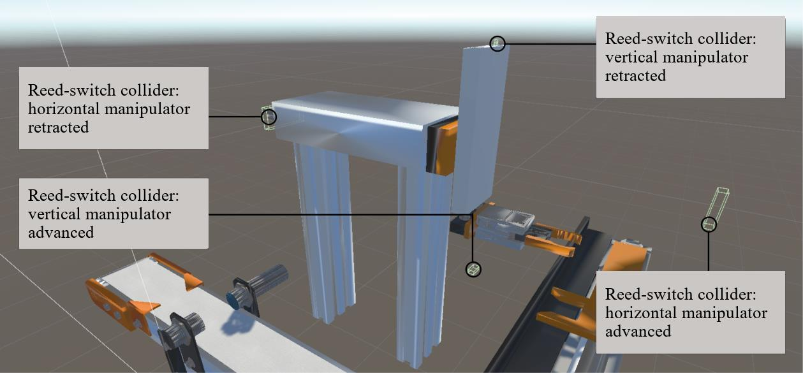

*Colliders of the reed switches of the Cartesian handling unit ([Souza, 2023](references.md), Fig. 3.26).*

## 5.5 CIM-B modules (phase 2)

Source: [Gomes (2025)](references.md), Section 3.3.

### Six-position rotary table

- **Motion:** the `RotacionarMesa` script reads the motor variable received from the PLC through OPC UA and, when it is TRUE, rotates the table at **25°/s**.
- **Carrying workpieces:** the table has colliders with `isTrigger` enabled at the points where workpieces are placed. When a workpiece touches one of them, `OnTriggerEnter` identifies the event and the `ColetaPeca` method makes the workpiece a child of the table (`transform.parent`), so that it rotates with the table and is carried between the stations.
- **Inductive sensor:** six pins were created under the table, 60° apart, representing the real metal pins. A collider represents the detection area of the inductive sensor: whenever a pin enters it, `OnTriggerEnter` sends TRUE to the variable `SnMesa`, indicating that the table has completed a 60° rotation and that the workpiece is aligned for the next step.


### Drilling module

- Two colliders work as limit switches: the lower one detects when the drill is **advanced** (tag `Ponto_FIM`) and the upper one when it is **retracted** (tag `Ponto_INI`).
- The `Update` method of the `Furadeira` script moves the drill with `transform.Translate` according to the PLC command: when `ValFur` is TRUE, the drill moves down; when it is FALSE, it retracts.
- When the drill touches the lower collider, `FurAva(true)` informs the PLC that it is fully advanced; when it touches the upper one, `FurRec(true)` signals that the retraction is complete.

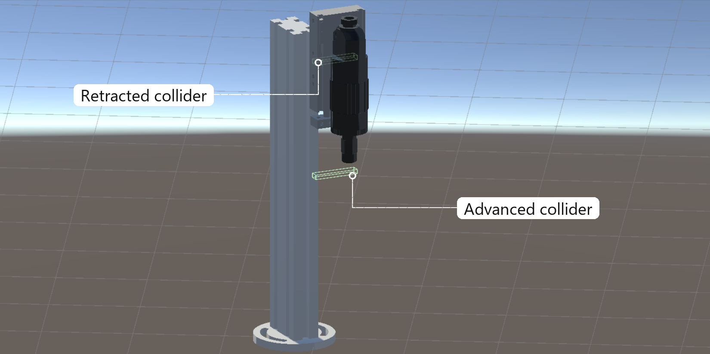

### Vision system

- The real camera inspects the workpiece by **similarity analysis**, comparing the captured image with references stored in a data bank. In the twin, this logic is reproduced by a simulated camera that performs the same type of verification by reading the **hole property of the workpiece**; image-based hole detection was not implemented.
- A collider below the camera detects the workpiece and is linked to the `PecaCamera` script.
- The inspection depends on the camera trigger and on three Boolean variables (`Bank1`, `Bank2`, `Bank3`), which form a binary value that selects the reference:

| Bank1 Bank2 Bank3 | Check | Logic in `PecaCamera` |
|---|---|---|
| 0 0 0 | **No workpiece** | If `ultimaPecaDetectada` is null — no workpiece entered the camera's field of view since the trigger — `OutCam(true)` is sent to the PLC |
| 1 0 0 | **Aluminum, 3 mm hole** | If a workpiece was detected, its `Specification` component is read; if `spec.furo` equals 3, TRUE is sent, validating the workpiece |
| 0 1 0 | **Steel, 6 mm hole** | Same logic for `spec.furo` equal to 6; otherwise, `OutCam(false)` signals that the workpiece does not match the selected reference |

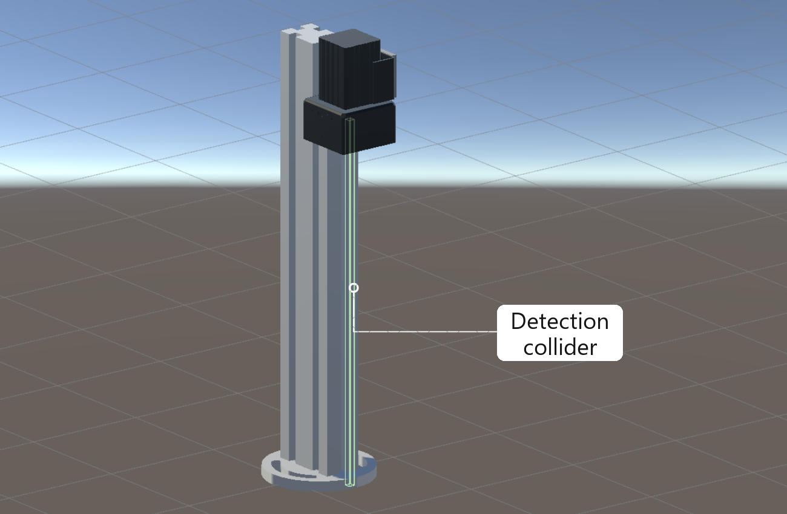

### Horizontal handling unit (HHU)

The HHU was modeled in Autodesk Inventor and refined in Blender, with special attention to the hierarchy and origin points because of its bidirectional movement. Five colliders reproduce its sensors: two for the vertical movement, two for the horizontal movement and one in the center of the gripper to detect and collect the workpiece.

- **Vertical actuator** (`UMH_Vertical` script): when `ValUmhV` is TRUE and the actuator has not reached the top (`UmhVAva` false), the HHU moves up; when `ValUmhV` is FALSE and it is not at the base (`UmhVRec` false), it moves down. The top and base positions are detected by colliders tagged `Ponto_FIM` and `Ponto_INI`.
- **Horizontal actuator** (`UMH_Horizontal` script): moves the gripper like an articulated arm, with one end facing the rotary table and the other the weighing module, according to `ValUmhB`. At each end, `OnTriggerEnter()` informs the PLC through `UmhBMesa(true)` or `UmhBCarga(true)`.
- **Gripper** (`Garra` script): when the gripper collider touches a workpiece tagged steel, aluminum or polymer, the workpiece becomes a child of the gripper (`transform.parent`) and moves with the HHU; the PLC is informed that the gripper collected it (`UmhGarra`). Opening and closing are commanded by `ValUmhG`.

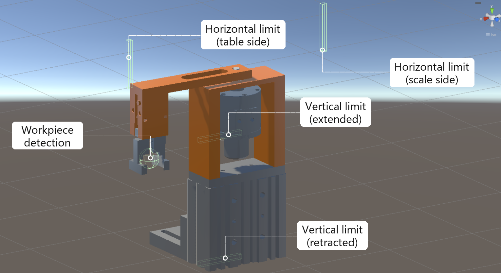

### Weighing module

- A collider placed on the platform of the scale acts as the contact point between the workpiece and the simulated load cell, linked to the `PecaBalanca` script.
- When a workpiece enters the collider, `OnTriggerEnter()` captures its mass through its **Rigidbody**. To simulate the measurement imprecision that occurs in the physical plant, the value is adjusted by a **random deviation of ±2 g**, rounded to two decimals and sent to the PLC through `PesoPeca(massa)`.
- When the workpiece is removed, `OnTriggerExit()` stops updating the mass, so the reading only occurs while the workpiece is on the scale.

```csharp
void Update()
{
    if(canUpdate){
        // Calculando o valor da massa e enviando ao CLP
        float massa = rb.mass;
        massa = Mathf.Round(Random.Range(massa - 2f, massa + 2f) * 100f) / 100f;
        opcua.PesoPeca(massa);
    }
}

private void OnTriggerEnter(Collider other)
{
    if (currentObject == other.gameObject) return;
    // Captura caracteristicas da peca
    currentObject = other.gameObject;
    canUpdate = true;
    rb = other.GetComponent<Rigidbody>();
}
```

*Excerpt of the `PecaBalanca` script, transcribed from [Gomes (2025)](references.md), Fig. 3.36.*

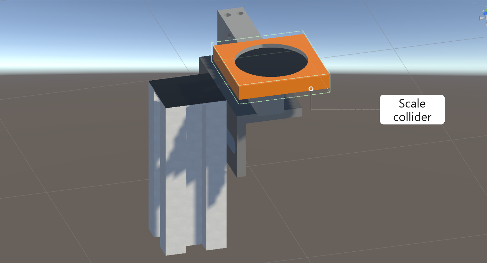

## 5.6 Summary

| Stage | Module | PLC outputs (actuators) | PLC inputs (sensors) | Emulation in Unity |
|---|---|---|---|---|
| CIM-A | Conveyor unit | `MEsteira` | `SnIndut`, `SnCap`, `SnOpt` | `ArrayList` moving the workpieces; trigger colliders on the sensors, using the workpiece tags |
| CIM-A | Linear transfer unit | `ValTransLin` | `TransLinRet`, `TransLinEst` | `transform` + `Lerp`; reed switches as colliders on empty objects |
| CIM-A | Cartesian handling unit | `ValHor`, `ValVert`, `ValGarra` | `HorRec`, `HorAva`, `VertRec`, `VertAva`, `GarraFechado` | Same as the transfer unit; gripper with `transform.rotation` + `Lerp` and `transform.parent` |
| CIM-B | Rotary table | `MMesa` | `SnMesa` | 25°/s rotation; six pins + sensor collider; seats parent the workpiece |
| CIM-B | Drilling module | `MFur`, `ValFur` | `FurAva`, `FurRec` | `transform.Translate`; two limit-switch colliders |
| CIM-B | Vision system | `TrigCam`, `Bank1`–`Bank3` | `OutCam` | Collider + hole property of the workpiece |
| CIM-B | Horizontal handling unit | `ValUmhV`, `ValUmhB`, `ValUmhG` | `UmhVAva`, `UmhVRec`, `UmhBMesa`, `UmhBCarga`, `UmhGarra` | Five colliders; gripper parents the workpiece |
| CIM-B | Weighing module | — | `PesoPeca` | Rigidbody mass ± 2 g, two decimals |

Variable names follow the PLC program of phase 2 — see the complete list in [Control logic](06-control-logic.md#inputs-and-outputs).

The 3D modeling and the animation allowed the twin to replicate not only the structure of the physical plant, but also its functionalities, behaviors and operational logic ([Gomes, 2025](references.md)).
