# 6. Control logic

This document describes the PLC program that operates the twin: its inputs and outputs, internal variables and operating sequence. For the concepts of GRAFCET and Ladder, see [Theoretical background](01-background.md#15-iec-61131-3-and-ladder).

**Contents:** [Approach](#61-approach) · [Inputs and outputs](#inputs-and-outputs) · [Internal variables](#63-internal-variables) · [Control sequence](#control-sequence) · [Phase 1: CIM-A in TIA Portal](#phase-1-cim-a-in-tia-portal)

---

## 6.1 Approach

**Phase 2 (current)** — [Gomes (2025)](references.md):

- The operating sequence of both stages was **modeled in GRAFCET**, used as a support tool to understand and present the operation flow, and drawn in diagrams.net.
- The control logic was **implemented in Ladder** in CODESYS, developed from the GRAFCET following the conversion methodology established in the literature (Moraes and Castrucci, 2007; Mendes, 2022). Ladder was chosen both for the author's familiarity with it and to demonstrate the versatility of the environment in supporting different programming languages; CODESYS also allows programming directly in GRAFCET.
- CODESYS simulates the PLC as well, providing a complete environment for testing and validating the process.

**Phase 1** — [Souza (2023)](references.md): the GRAFCET of CIM-A was drawn in diagrams.net as a visual sketch and then programmed in GRAFCET in TIA Portal.

The implemented logic demonstrates how the plant can be operated. **Other logics can be implemented**, as long as they respect the position of the sensors and the advance and retraction limits of the actuators — which allows students of the Integrated Manufacturing Systems course to implement the logic developed in class ([Souza, 2023](references.md)).

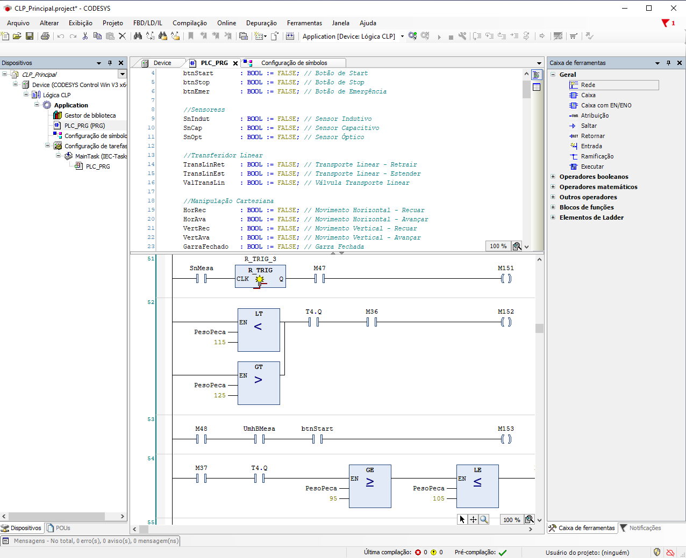

*Ladder program of the twin in CODESYS V3.5 SP20 Patch 5 ([Gomes, 2025](references.md), Fig. 2.4).*

## 6.2 Inputs and outputs

The inputs represent the signals of the sensors simulated in the twin, which inform the PLC of the current state of each module; the outputs are the commands issued by the PLC, which drive the actuators of the twin ([Gomes, 2025](references.md)).

- **PLC variable:** name in the CODESYS program ([Gomes, 2025](references.md), Tables 3.1 and 3.2).
- **Configuration field:** label of the corresponding field in the configuration screen of the twin, where its NodeId is entered ([Gomes, 2025](references.md), Fig. 4.4).
- **Type:** all signals are Boolean, except the weight, which is a Float ([Gomes, 2025](references.md), Fig. 2.5).

### Inputs (23)

| Stage | Module | Description | PLC variable | Configuration field |
|---|---|---|---|---|
| CIM-A | Push buttons | Start button | `btnStart` | `Btn_Start` |
| CIM-A | Push buttons | Stop button | `btnStop` | `Btn_Stop` |
| CIM-A | Push buttons | Emergency button | `btnEmer` | `Btn_Emer` |
| CIM-A | Conveyor unit | Conveyor inductive sensor | `SnIndut` | `Sn_Indut_Este` |
| CIM-A | Conveyor unit | Conveyor capacitive sensor | `SnCap` | `Sn_Cap_Este` |
| CIM-A | Conveyor unit | Conveyor optical sensor | `SnOpt` | `Sn_Opt_Este` |
| CIM-A | Linear transfer unit | Linear transfer retracted | `TransLinRet` | `Tran_Lin_Ret` |
| CIM-A | Linear transfer unit | Linear transfer extended | `TransLinEst` | `Tran_Lin_Est` |
| CIM-A | Cartesian handling unit | Horizontal retracted | `HorRec` | `Hor_Rec` |
| CIM-A | Cartesian handling unit | Horizontal advanced | `HorAva` | `Hor_Ava` |
| CIM-A | Cartesian handling unit | Vertical retracted | `VertRec` | `Vert_Rec` |
| CIM-A | Cartesian handling unit | Vertical advanced | `VertAva` | `Vert_Ava` |
| CIM-A | Cartesian handling unit | Gripper closed | `GarraFechado` | `Garra_Vert_Fechado` |
| CIM-B | Rotary table | Inductive sensor | `SnMesa` | `Sn_Mesa` |
| CIM-B | Drilling module | Drill advanced | `FurAva` | `Fur_Ava` |
| CIM-B | Drilling module | Drill retracted | `FurRec` | `Fur_Rec` |
| CIM-B | Vision system | Camera output | `OutCam` | `Out_Cam` |
| CIM-B | Horizontal handling unit | Vertical actuator advanced (top) | `UmhVAva` | `Umh_V_Ava` |
| CIM-B | Horizontal handling unit | Vertical actuator retracted (base) | `UmhVRec` | `Umh_V_Rec` |
| CIM-B | Horizontal handling unit | Horizontal on the table side | `UmhBMesa` | `Umh_B_Mesa` |
| CIM-B | Horizontal handling unit | Horizontal on the scale side | `UmhBCarga` | `Umh_B_Carga` |
| CIM-B | Horizontal handling unit | Gripper closed | `UmhGarra` | `Umh_Garra` |
| CIM-B | Weighing module | Workpiece weight (Float) | `PesoPeca` | `Peso_Peca` |

### Outputs (15)

| Stage | Module | Description | PLC variable | Configuration field |
|---|---|---|---|---|
| CIM-A | Conveyor unit | Conveyor motor | `MEsteira` | `M_Esteira` |
| CIM-A | Linear transfer unit | Linear transfer actuator | `ValTransLin` | `Val_Trans_Lin` |
| CIM-A | Cartesian handling unit | Horizontal actuator | `ValHor` | `Val_Hor` |
| CIM-A | Cartesian handling unit | Vertical actuator | `ValVert` | `Val_Vert` |
| CIM-A | Cartesian handling unit | Gripper actuator | `ValGarra` | `Val_Garra_Vert` |
| CIM-B | Rotary table | Table motor | `MMesa` | `M_Mesa` |
| CIM-B | Drilling module | Drill motor | `MFur` | `M_Fur` |
| CIM-B | Drilling module | Drill feed actuator | `ValFur` | `Val_Fur` |
| CIM-B | Vision system | Camera trigger | `TrigCam` | `Trig_Cam` |
| CIM-B | Vision system | Bank 1 | `Bank1` | `Bank1` |
| CIM-B | Vision system | Bank 2 | `Bank2` | `Bank2` |
| CIM-B | Vision system | Bank 3 | `Bank3` | `Bank3` |
| CIM-B | Horizontal handling unit | Horizontal actuator | `ValUmhB` | `Val_Umh_B` |
| CIM-B | Horizontal handling unit | Vertical actuator | `ValUmhV` | `Val_Umh_V` |
| CIM-B | Horizontal handling unit | Gripper actuator | `ValUmhG` | `Val_Umh_G` |

The location of each signal in the twin is shown below:

<table>
  <tr>
    <td>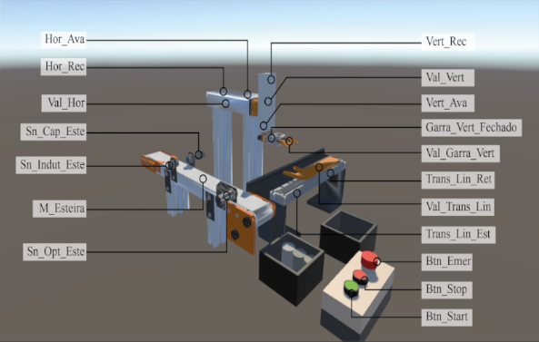</td>
    <td>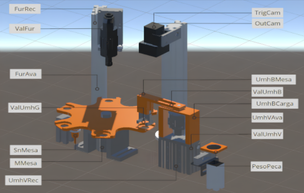</td>
  </tr>
  <tr>
    <td align="center"><em>CIM-A</em></td>
    <td align="center"><em>CIM-B</em></td>
  </tr>
</table>

## 6.3 Internal variables

Besides the inputs and outputs, the program uses the following internal variables, as shown in the GRAFCET ([Gomes, 2025](references.md)):

| Variable | Meaning |
|---|---|
| `M0` – `M50` | Step memories of the GRAFCET |
| `M101` – `M157` | Labels of the transitions |
| `M00` | Metallic workpiece (set by the inductive sensor) |
| `M01` | Non-metallic (polymer) workpiece |
| `M02` | 3 mm hole identified (aluminum) |
| `M03` | 6 mm hole identified (steel) |
| `T1`, `T2`, `T3` | Timers of the camera checks: no workpiece, 3 mm hole and 6 mm hole |
| `T4` | Weighing timer, which stabilizes the reading and guarantees a minimum time |
| `CTU0` | Counter of table rotations used at the end of the process |

## 6.4 Control sequence

The complete GRAFCET of phase 2 has steps **M0 to M50**. The tables below transcribe it phase by phase ([Gomes, 2025](references.md), Section 3.4 and Figs. 3.39–3.46). Actions use **S** (set) and **R** (reset); `¬` denotes a negated signal, `↑`/`↓` a rising/falling edge, `·` AND and `∨` OR.

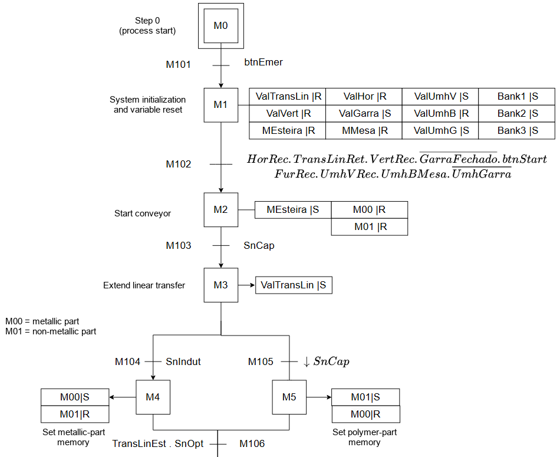

### Initialization

| Step | What happens | Actions | Transition → next step |
|---|---|---|---|
| M0 | Initial step: the system remains at rest | — | M101: `btnEmer` (emergency button released) → M1 |
| M1 | System initialization: actuators are repositioned and variables reset | R `ValTransLin`, `ValHor`, `ValVert`, `MEsteira`, `ValUmhB`, `MMesa`; S `ValGarra`, `ValUmhV`, `ValUmhG`, `Bank1`, `Bank2`, `Bank3` | M102: `HorRec · TransLinRet · VertRec · ¬GarraFechado · btnStart · FurRec · UmhVRec · UmhBMesa · ¬UmhGarra` → M2 |

### Conveyor and classification (CIM-A)

| Step | What happens | Actions | Transition → next step |
|---|---|---|---|
| M2 | Conveyor on; workpiece-type memories reset | S `MEsteira`; R `M00`, `M01` | M103: `SnCap` → M3 |
| M3 | Linear transfer extends | S `ValTransLin` | M104: `SnIndut` → M4 · M105: `↓SnCap` → M5 |
| M4 | Metallic workpiece memory | S `M00`; R `M01` | M106: `TransLinEst · SnOpt` → M6 |
| M5 | Polymer workpiece memory | S `M01`; R `M00` | M106: `TransLinEst · SnOpt` → M6 |

### Transport to the rotary table (CIM-A → CIM-B)

| Step | What happens | Actions | Transition → next step |
|---|---|---|---|
| M6 | Linear transfer retracts; conveyor off | R `MEsteira`, `ValTransLin` | M107: `TransLinRet` → M7 |
| M7 | Cartesian manipulator moves down towards the workpiece | S `ValVert` | M108: `VertAva` → M8 |
| M8 | Gripper holds the workpiece | R `ValGarra` | M109: `GarraFechado` → M9 |
| M9 | Manipulator lifts the workpiece | R `ValVert` | M110: `VertRec · ((M00 · btnStart) ∨ M01)` → M10 — *inspection point for metallic workpieces* |
| M10 | Manipulator moves horizontally | S `ValHor` | M111: `HorAva · ((M00 · ¬M01) ∨ (M01 · ¬M00))` → M11 |
| M11 | Workpiece is lowered towards the table | S `ValVert` | M112: `VertAva · ((M00 · ¬M01) ∨ (M01 · ¬M00 · btnStart))` → M12 — *inspection point for polymer workpieces* |
| M12 | Gripper releases the workpiece on the table | S `ValGarra` | M113: `¬GarraFechado` → M13 |
| M13 | Manipulator moves up | R `ValVert` | M114: `VertRec` → M14 |
| M14 | Manipulator returns to its initial position, fully retracted | R `ValHor` | M115: `HorRec` → M15 |

### Drilling

| Step | What happens | Actions | Transition → next step |
|---|---|---|---|
| M15 | Table rotates to place the workpiece under the drill | S `MMesa` | M116: `↑SnMesa` → M16 |
| M16 | Table stops; drill turned on | R `MMesa`; S `MFur` | M117: `MFur` → M17 |
| M17 | Drill moves down towards the workpiece | S `ValFur` | M118: `FurAva` → M18 |
| M18 | Drill returns to its initial position | R `ValFur` | M119: `FurRec` → M19 |
| M19 | Drill turned off | R `MFur` | M120: `¬MFur` → M20 |

### Vision inspection

| Step | What happens | Actions | Transition → next step |
|---|---|---|---|
| M20 | Table rotates to place the workpiece under the camera; camera triggered | S `MMesa`, `TrigCam` | M121: `↑SnMesa` → M21 |
| M21 | Table stops with the workpiece under the camera | R `MMesa` | M122: `btnStart` → M22 |
| M22 | Camera configured to check whether there is a workpiece (bank 000) | R `Bank1`, `Bank2`, `Bank3`; S `T1` | M123: `T1 · OutCam` → M2 (no workpiece) · M150: `T1 · ¬OutCam · M01` → M47 · M124: `T1 · ¬OutCam · M00` → M23 |
| M47 | Polymer workpiece: no inspection; the table rotates straight to the removal position | R `Bank1`, `Bank2`, `Bank3`, `TrigCam`; S `MMesa` | M151: `↑SnMesa` → final steps (M45) |
| M23 | Camera configured to check for a 3 mm hole (bank 100) | S `Bank1`; R `Bank2`, `Bank3`; S `T2` | M125: `T2 · OutCam` → M24 · M126: `T2 · ¬OutCam` → M25 |
| M24 | 3 mm hole memory | S `M02`; R `M03` | M128: `M02 · ¬M03` → M27 |
| M25 | Camera configured to check for a 6 mm hole (bank 010) | R `Bank1`; S `Bank2`; R `Bank3`; S `T3` | M127: `T3 · OutCam` → M26 · M130: `T3 · ¬OutCam` → M28 |
| M26 | 6 mm hole memory | R `M02`; S `M03` | M129: `M03 · ¬M02` → M27 |
| M28 | Workpiece not recognized as any possible type: camera trigger off | R `TrigCam` | M131: `↑btnStart` → M2 |
| M27 | Banks reset; table rotates to place the workpiece in front of the HHU | R `Bank1`, `Bank2`, `Bank3`, `TrigCam`; S `MMesa` | M132: `↑SnMesa` → M29 |

### Transfer to the scale

| Step | What happens | Actions | Transition → next step |
|---|---|---|---|
| M29 | Table stops; HHU gripper moves down | R `MMesa`, `ValUmhV` | M133: `UmhVRec` → M30 |
| M30 | Gripper holds the workpiece | R `ValUmhG` | M134: `UmhGarra` → M31 |
| M31 | Gripper moves up | S `ValUmhV` | M135: `UmhVAva` → M32 |
| M32 | HHU turns towards the scale | S `ValUmhB` | M136: `UmhBCarga` → M33 |
| M33 | Gripper moves down | R `ValUmhV` | M137: `UmhVRec` → M34 |
| M34 | Gripper opens, leaving the workpiece on the scale | S `ValUmhG` | M138: `¬UmhGarra` → M35 |
| M35 | Gripper moves up | S `ValUmhV` | M139: `UmhVAva · M03 · ¬M02` → M36 (steel) · M140: `UmhVAva · M02 · ¬M03` → M37 (aluminum) |

### Weighing

| Step | What happens | Actions | Transition → next step |
|---|---|---|---|
| M36 | Steel path: weighing timer started | S `T4` | M141: `T4 · (PesoPeca ≥ 115 · PesoPeca ≤ 125)` → M38 · M152: `T4 · (PesoPeca < 115 ∨ PesoPeca > 125)` → M48 |
| M37 | Aluminum path: weighing timer started | S `T4` | M154: `T4 · (PesoPeca ≥ 95 · PesoPeca ≤ 105)` → M49 · M156: `T4 · (PesoPeca < 95 ∨ PesoPeca > 105)` → M50 |
| M38 / M49 | Correct weight: gripper moves down to take the workpiece | R `ValUmhV` | M142 / M155: `UmhVRec` → M39 |
| M48 / M50 | Incorrect weight: HHU turns back towards the table | R `ValUmhB` | M153 / M157: `UmhBMesa · ↑btnStart` → M2 |

### Return and removal

| Step | What happens | Actions | Transition → next step |
|---|---|---|---|
| M39 | Gripper holds the workpiece | R `ValUmhG` | M143: `UmhGarra` → M40 |
| M40 | Gripper moves up | S `ValUmhV` | M144: `UmhVAva` → M41 |
| M41 | HHU turns towards the table | R `ValUmhB` | M145: `UmhBMesa` → M42 |
| M42 | Gripper moves down, placing the workpiece on the table | R `ValUmhV` | M146: `UmhVRec` → M43 |
| M43 | Gripper releases the workpiece | S `ValUmhG` | M147: `¬UmhGarra` → M44 |
| M44 | Gripper moves up again | S `ValUmhV` | M148: `UmhVAva` → M45 |
| M45 | Table rotates; counter started to count two table rotations | S `MMesa`; `CTU0` | M149: `CTU0` → M46 |
| M46 | Table turned off — end of the cycle | R `MMesa` | M150: `btnStart` → M2 |

At the end of the cycle, the system remains at rest until the Start button is pressed, starting a new complete process.

<strong>Full GRAFCET diagrams</strong> (original figures; comments in Portuguese)

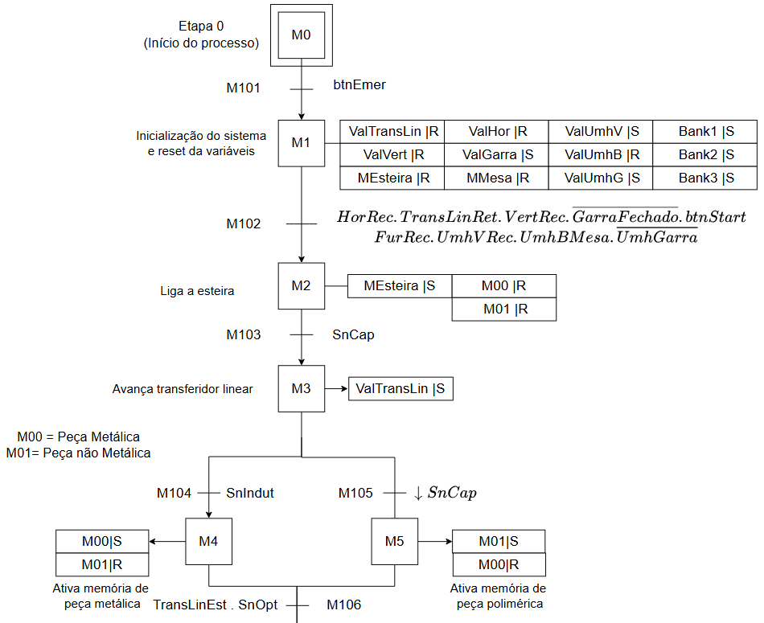
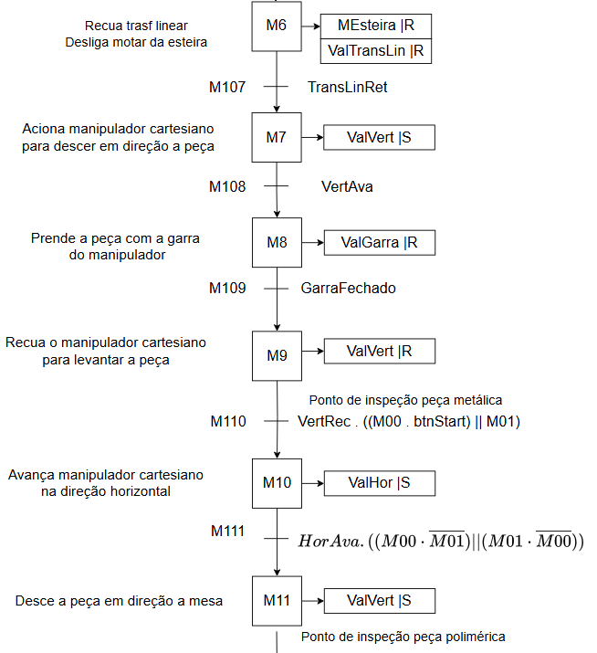
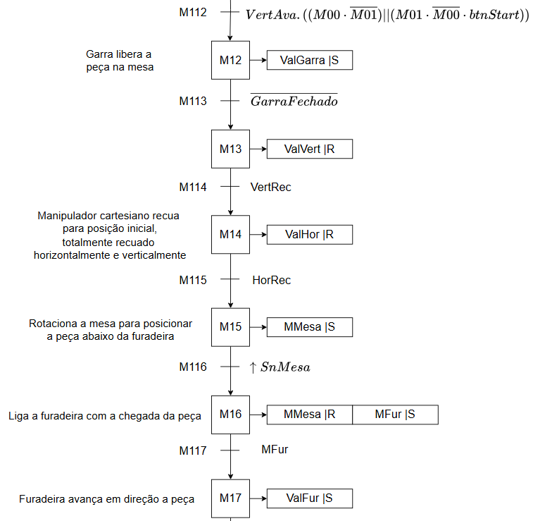
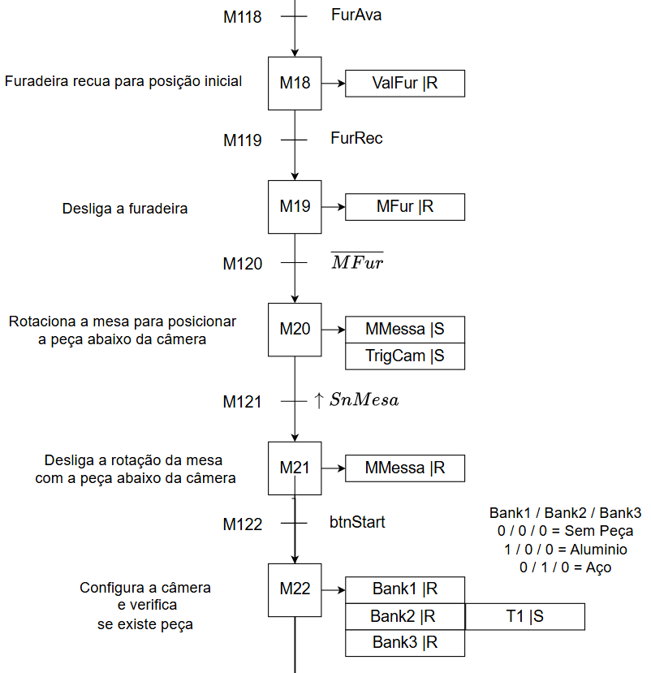
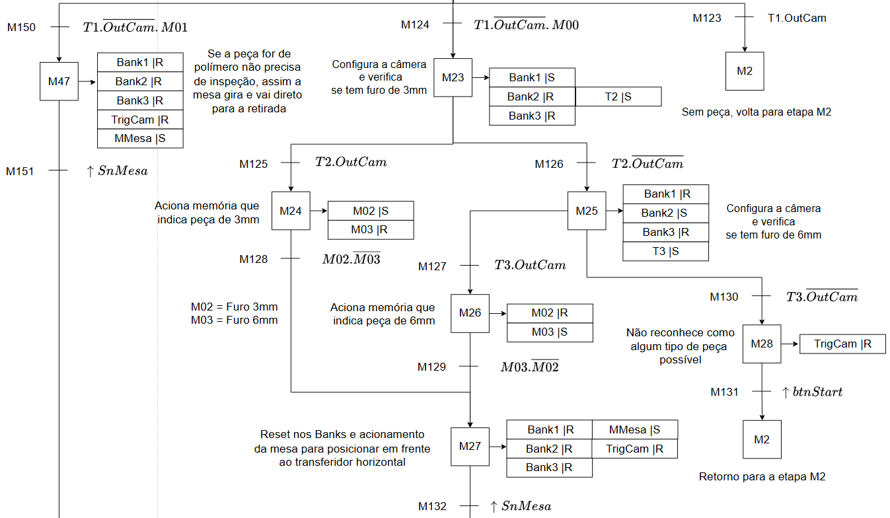
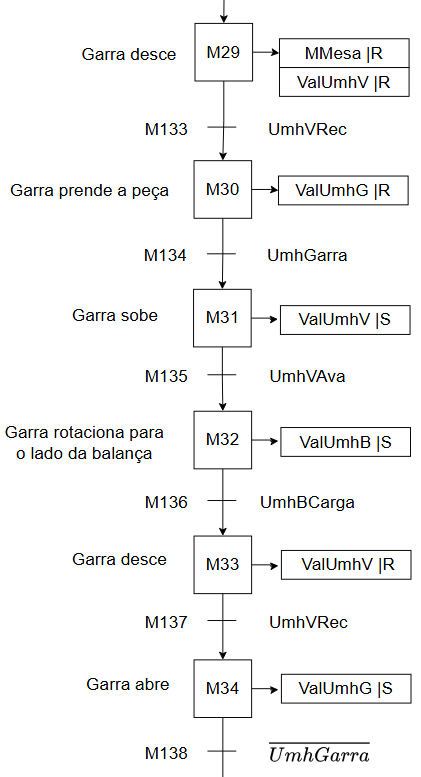
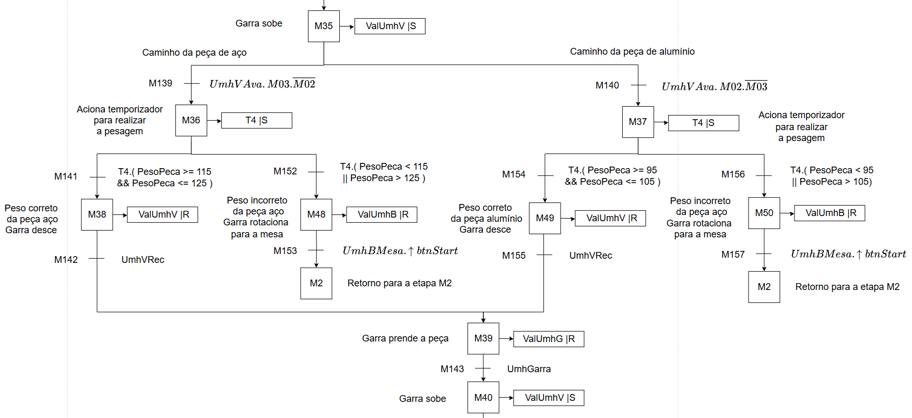
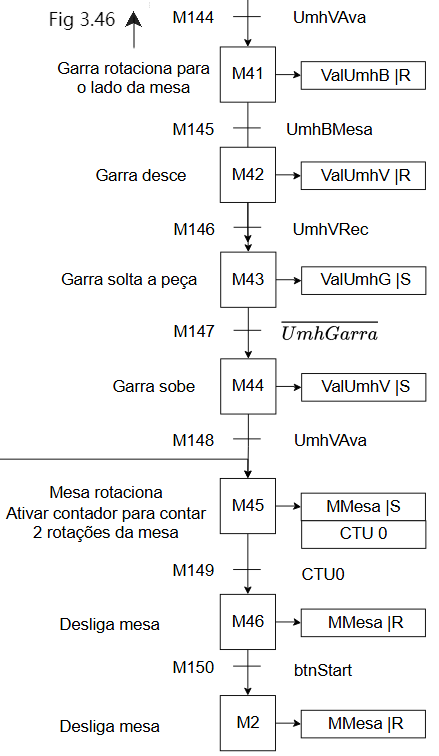

*Source: [Gomes (2025)](references.md), Figs. 3.39–3.46.*

## 6.5 Phase 1: CIM-A in TIA Portal

In phase 1, the CIM-A twin was controlled by a GRAFCET programmed in TIA Portal, with the variables below and their OPC UA addresses ([Souza, 2023](references.md), Tables 3.1 and 3.2):

| Inputs | OPC UA address | Outputs | OPC UA address |
|---|---|---|---|
| `Btn_Start` | `ns=4;i=2` | `M_Esteira` | `ns=4;i=16` |
| `Btn_Stop` | `ns=4;i=3` | `Val_Trans_Lin` | `ns=4;i=17` |
| `Btn_Emer` | `ns=4;i=4` | `Val_Hor` | `ns=4;i=18` |
| `Sn_Indut_Este` | `ns=4;i=5` | `Val_Vert` | `ns=4;i=19` |
| `Sn_Cap_Este` | `ns=4;i=6` | `Val_Garra_Vert` | `ns=4;i=20` |
| `Sn_Opt_Este` | `ns=4;i=7` | | |
| `Trans_Lin_Ret` | `ns=4;i=8` | | |
| `Trans_Lin_Est` | `ns=4;i=9` | | |
| `Hor_Rec` | `ns=4;i=10` | | |
| `Hor_Ava` | `ns=4;i=11` | | |
| `Vert_Rec` | `ns=4;i=12` | | |
| `Vert_Ava` | `ns=4;i=13` | | |
| `Garra_Vert_Fechado` | `ns=4;i=14` | | |

Three memories supported the logic: `M0.0` (metallic workpiece), `M0.1` (polymer workpiece) and `M0.2` (start/stop).

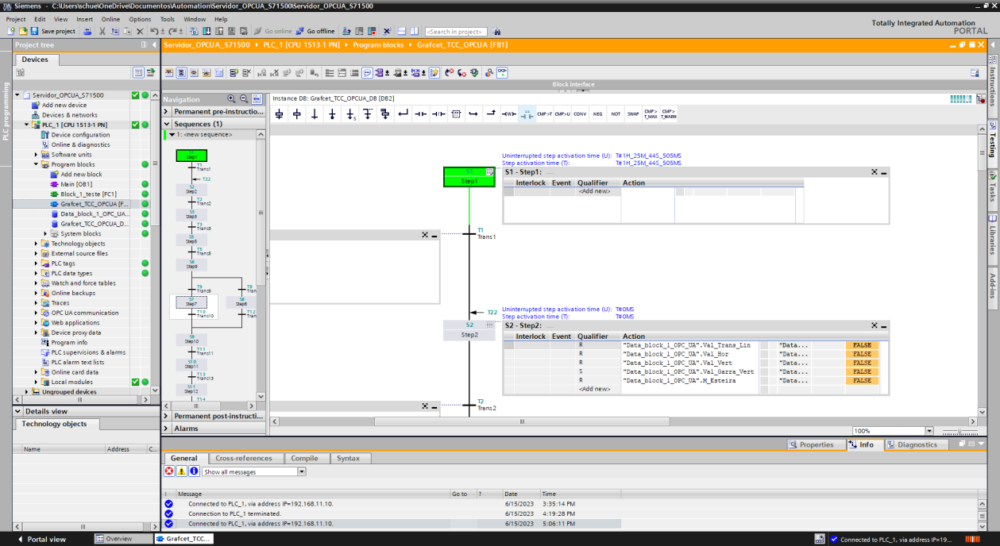

*User program of phase 1 in TIA Portal ([Souza, 2023](references.md), Fig. 2.3).*

**Sequence of a metallic workpiece (steps S1–S16)** ([Souza, 2023](references.md), Section 4.1):

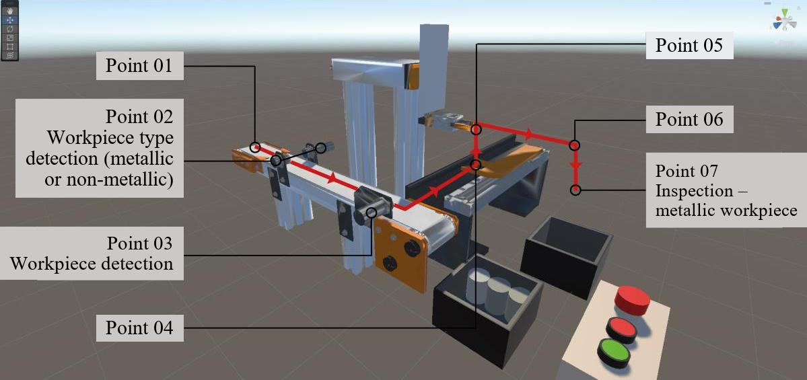

1. **S1** is the start of the process: a metallic workpiece is added at Point 01 by clicking on one of the three pieces in the box at the end of the conveyor of the twin.
2. To move on, the emergency button of the twin (`Btn_Emer`) must be released.
3. **S2** retracts the linear transfer (`Val_Trans_Lin`) and the horizontal (`Val_Hor`) and vertical (`Val_Vert`) actuators, opens the gripper (`Val_Garra_Vert`) and turns off the conveyor (`M_Esteira`), ensuring that the units are retracted, the conveyor is off and the gripper is open.
4. The receptivities check these actions: `Trans_Lin_Ret`, `Hor_Rec`, `Vert_Rec` and the opening of the gripper (`Garra_Vert_Fechado`).
5. **S3** is empty: no action is taken until Start is pressed. With the workpiece in place, `Btn_Start` starts the process.
6. The workpiece moves to Point 02, where it is detected: when the capacitive sensor (`Sn_Cap_Este`) detects it, **S6** extends the linear transfer (`Val_Trans_Lin`).
7. As the workpiece is metallic, the inductive sensor (`Sn_Indut_Este`) detects it and **S7** sets memory `M0.0`, which stores that there is a metallic workpiece in the twin.
8. The workpiece reaches Point 03, where it is detected by the optical sensor (`Sn_Opt_Este`), and the reed switch of the linear transfer (`Trans_Lin_Est`) indicates that it is extended.
9. **S9** turns off the conveyor (`M_Esteira`) and the linear transfer (`Val_Trans_Lin`), which retracts, taking the workpiece to Point 04.
10. When the transfer retracts (`Trans_Lin_Ret`), **S10** advances the vertical actuator (`Val_Vert`); when it reaches `Vert_Ava`, **S11** closes the gripper (`Val_Garra_Vert` low), and the gripper sensor (`Garra_Vert_Fechado`) indicates that it is closed.
11. The vertical actuator is then reset, taking the workpiece up to Point 05; when it retracts (`Vert_Rec`), **S13** sets the horizontal actuator (`Val_Hor`), which advances to Point 06.
12. As the workpiece is metallic, the condition `M0.0` is satisfied together with the horizontal reed switch, and **S14** sets the vertical actuator (`Val_Vert`), taking the workpiece to Point 07.
13. Point 07 is the **inspection point of metallic workpieces**: the transition requires `M0.0`, `Hor_Ava`, `Vert_Ava` and `Btn_Start` high and `M0.1` low — after inspecting the workpiece, the operator presses Start.
14. **S15** opens the gripper (`Val_Garra_Vert`), depositing the workpiece in the box of the twin; the gripper sensor (`Garra_Vert_Fechado`) goes low.
15. **S16** returns all actuators to their initial positions and clears the workpiece-type memories.
16. The system restarts at **S2**, waiting for the Start button.

The polymer workpiece follows the same path, changing only the inspection point, which is **Point 06**; the information that the workpiece is made of polymer is stored in memory `M0.1` in step S8.

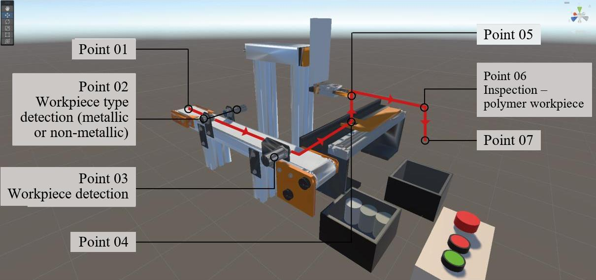

*Routes of the metallic and polymer workpieces in the CIM-A twin ([Souza, 2023](references.md), Figs. 4.3 and 4.4).*

**Start/Stop.** The memory `M0.2` was inserted in all transitions between steps S5 and S16 and handled in a separate function (FC): pressing Stop (`Btn_Stop`) resets `M0.2`, pausing the evolution between steps; pressing Start (`Btn_Start`) sets it, resuming the process.

  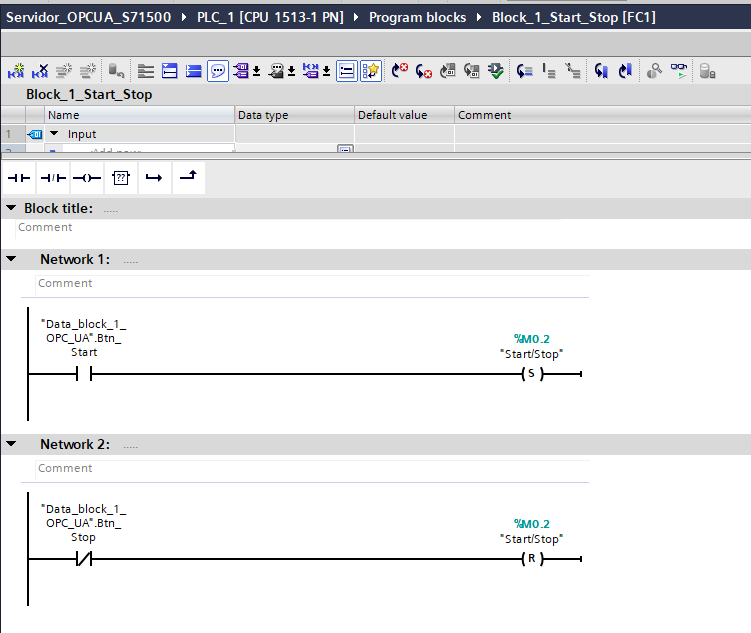

*Function (FC) that implements the Start/Stop ([Souza, 2023](references.md), Fig. 4.5).*

<strong>Full GRAFCET of phase 1</strong>

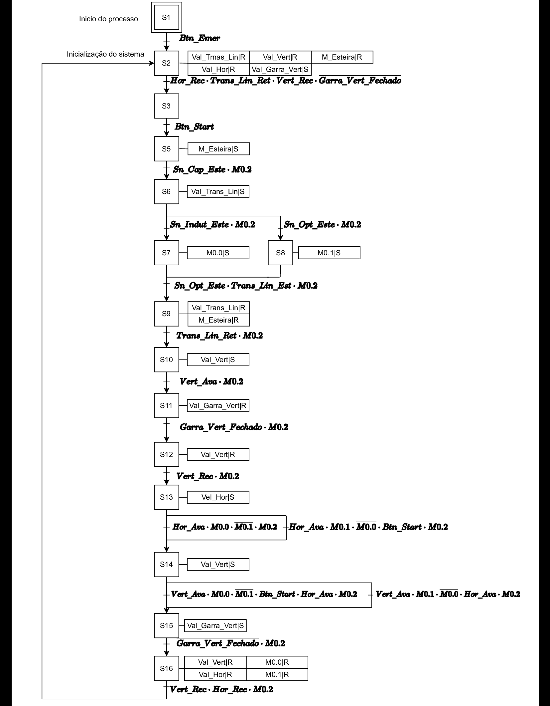

*Source: [Souza (2023)](references.md), Fig. 3.35.*

